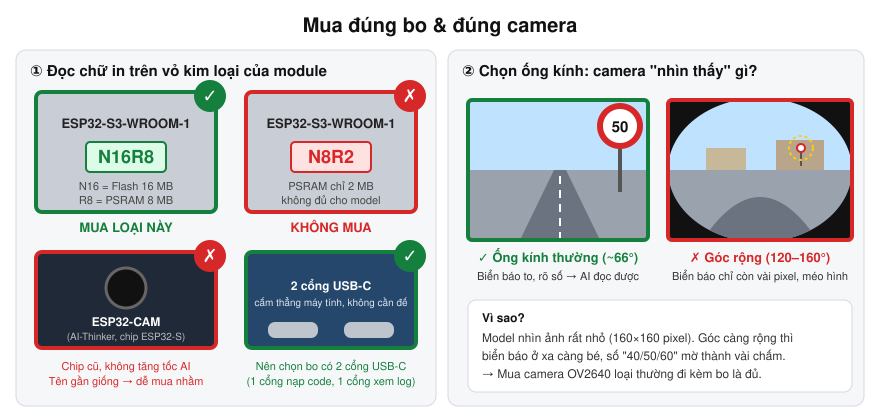
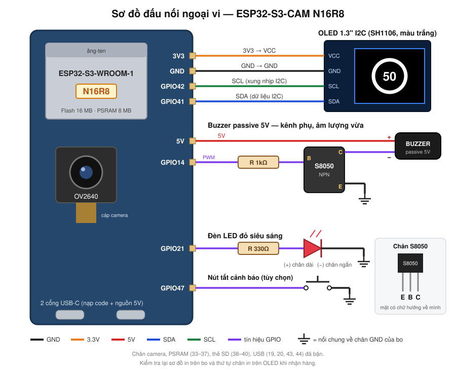
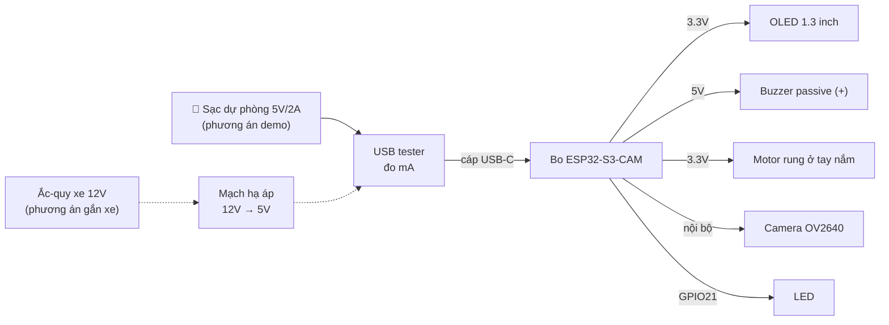
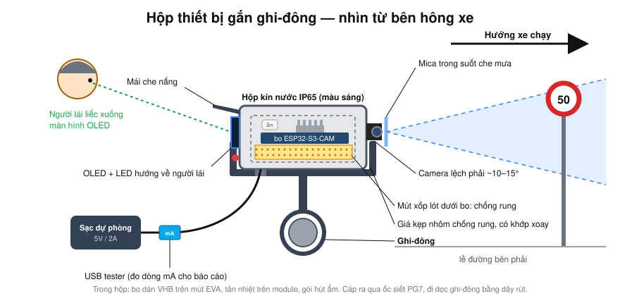

# [D1] BOM & Thông số phần cứng — ESP32-S3-CAM N16R8

* **Phụ trách:** Vũ Văn Duy (`26410031`) — Kỹ sư Nhúng & Thực nghiệm
* **Trạng thái:** 🟡 Đề xuất — chờ đặt hàng & xác nhận pinout trên bo thật
* **Mở khóa cho:** `[H2]` Hôn (đấu OLED/Buzzer/LED theo bảng chân Mục 3), `[S1]/[S2]` Sơn (ngân sách bộ nhớ Mục 4)

> Giá trong tài liệu là **ước tính tham khảo** (tháng 11/2026); kiểm tra lại trên Shopee / Lazada / Hshop.vn / ICDayRoi / Nshop trước khi đặt.

---

## 1. Chọn bo mạch

**Chốt:** bo **"ESP32-S3-CAM N16R8"** (module `ESP32-S3-WROOM-1-N16R8`, camera `OV2640`, 2 cổng Type-C), loại có **sơ đồ chân camera tương thích Freenove ESP32-S3-WROOM CAM**.

| Tiêu chí | ESP32-S3-CAM N16R8 (Freenove/clone) ⭐ | Seeed XIAO ESP32S3 Sense | ESP32-CAM (AI-Thinker, chip cũ) |
|---|---|---|---|
| Flash / PSRAM | **16 MB / 8 MB Octal** | 8 MB / 8 MB | 4 MB / 4 MB |
| Tăng tốc AI (vector) | Có (LX7) | Có (LX7) | **Không** (LX6) → loại |
| Chân trống cho OLED/Buzzer/LED | Nhiều | Rất ít | Rất ít |
| USB nạp code | Có sẵn (Type-C) | Có | Cần đế MB |
| Giá ước tính | ~150–350k ₫ | ~400–600k ₫ | ~120k ₫ |

**Khi mua, kiểm tra trong ảnh/mô tả sản phẩm:**
- Tên module in trên vỏ kim loại: **`ESP32-S3-WROOM-1` … `N16R8`** (không mua N8R2, N4, hoặc "ESP32-CAM" đời cũ).
- Kèm camera **OV2640 góc thường (~66°)**. **Không** chọn ống kính góc rộng 120–160°: biển báo ở xa sẽ còn vài pixel, mô hình khó nhận.
- Bo có 2 cổng Type-C (một cổng USB-OTG, một cổng UART/CH340) → dễ nạp và xem log.

### 1.1 Nơi mua tham khảo (xem ảnh thật của bo tại link shop)

| Shop | Sản phẩm | Giá (xem ngày 18/11/2026) | Ghi chú |
|---|---|---:|---|
| [Điện tử Đức Huy](https://dientuduchuy.com/products/esp32-s3-n16r8-esp32-s3-cam-wifi-tich-hop-camera-bao-gom-ov2640) | ESP32-S3 WROOM N16R8 + OV2640 | 300.000 ₫ | Ghi rõ 2 cổng USB-C, Flash 16 MB + PSRAM 8 MB, khe SD, LED RGB. **Đang hết hàng** |
| [Điện tử Tuyết Nga](https://dientutuyetnga.com/products/esp32-cam-kit-phat-trien-esp32-s3-n16r8-ov2640-typec) | ESP32-S3 N16R8 + OV2640 Type-C | 205.000 ₫ | Trang không ghi số cổng USB-C và tồn kho; shop có ghi chú thông số có thể chưa cập nhật → hỏi shop trước khi đặt |
| Shopee / Lazada | "ESP32-S3-CAM N16R8" | ~75–350k ₫ | Có bản đi kèm **OV5640** (5MP) — xem ghi chú dưới |

**OV2640 hay OV5640?** Cả hai cắm chung một cổng camera và thư viện `esp32-camera` tự nhận loại cảm biến, nên firmware không cần sửa. Nhưng model AI chỉ nhìn ảnh 160×160, nên độ phân giải 5MP của OV5640 không giúp gì, lại tốn điện và nóng hơn. → **Chọn OV2640** nếu có; chỉ lấy OV5640 khi shop hết bản OV2640.

Không shop nào ở trên ghi sơ đồ chân camera, nên vẫn phải kiểm tra bằng firmware `mock_inference_test` khi nhận hàng (Mục 6).

👉 **Mua 2 bo** (1 chính + 1 dự phòng): chỉ thêm khoảng 200k nhưng tránh mất cả tuần nếu bo bị chập/cháy.

---

## 2. BOM — danh sách mua

Chia 4 nhóm theo thứ tự mua: **A–B mua ngay** (để test trên bàn ở Tuần 5–6), **C mua khi chốt lắp lên xe** (Tuần 6), **D là dụng cụ đo** (mượn được thì mượn). Lý do của từng món ở nhóm B–C nằm trong [Mục 5](#5-yếu-tố-thực-tế-khi-chạy-xe-máy).

### A. Mạch chính

| # | Linh kiện | SL | Ghi chú chọn mua | Giá ước tính |
|---|---|:---:|---|---:|
| A1 | Bo ESP32-S3-CAM N16R8 + OV2640 | 2 | Như Mục 1 (1 chính + 1 dự phòng) | 400–600k |

### B. Ngoại vi cảnh báo

| # | Linh kiện | SL | Ghi chú chọn mua | Giá ước tính |
|---|---|:---:|---|---:|
| B1 | **OLED 1.3" I2C 128×64, chip SH1106, màu trắng** | 1 | Loại **4 chân I2C** (không lấy loại SPI 7 chân). Chọn **màu trắng một màu** — sáng và tương phản tốt hơn loại 2 màu vàng/xanh. ⚠️ Nhiều module 1.3" xếp chân **VCC–GND–SCL–SDA** (ngược với 0.96") → đọc chữ in trên module trước khi cắm | 80–120k |
| B2 | **Motor rung đồng xu 3V** (coin vibration motor, Ø10 mm, có dây sẵn) | 2 | **Kênh cảnh báo chính**: dán ở tay nắm, chỉ người lái cảm nhận — không làm ồn người xung quanh, vẫn cảm được khi gió to, đeo găng, trùm áo mưa. Không dán trong hộp camera (rung làm nhòe ảnh) | 10–20k |
| B3 | Diode **1N4148** (hoặc 1N4007) | 3 | Gắn ngược song song motor để bảo vệ transistor khi motor tắt | 3k |
| B4 | **Buzzer passive 5V** Ø12 mm | 2 | Kênh phụ: phát được nhiều kiểu tiếng khác nhau (cấm: dồn dập; tốc độ: 1 tiếng), âm lượng vừa, hướng về người lái. Có nút tắt | 5–10k |
| B4b | Transistor NPN **S8050** + điện trở 1kΩ | 5 | "Công tắc" cho motor và buzzer (mỗi thứ 1 con) | 10k |
| B5 | **LED đỏ siêu sáng 5mm** + điện trở 220–330Ω | 5 | Loại siêu sáng (super bright) để nhìn thấy cả ban ngày, nằm trong vùng mắt liếc thấy | 5–10k |
| B6 | Nút nhấn 12mm **có nắp chống nước** | 1 | Bấm được khi đeo găng tay để tắt còi | 10–20k |

### C. Lắp lên xe máy (yếu tố thực tế)

| # | Linh kiện | SL | Ghi chú chọn mua | Giá ước tính |
|---|---|:---:|---|---:|
| C1 | **Hộp điện kín nước IP65**, màu trắng/xám, ~100×68×50 mm | 1 | Kín mưa; màu sáng để đỡ nóng khi phơi nắng | 40–80k |
| C2 | Ốc siết cáp **PG7** | 2 | Luồn cáp USB vào hộp mà không hở nước | 5–10k |
| C3 | Tấm **mica trong 2mm** + keo silicon | 1 | Cửa sổ cho camera và OLED | 10–20k |
| C4 | **Giá đỡ điện thoại xe máy loại kẹp nhôm, chống rung** (có khớp xoay) | 1 | Loại nhựa rẻ rung lắc mạnh làm ảnh camera bị nhòe. Khớp xoay để chỉnh camera lệch về lề phải | 100–200k |
| C5 | Bo **đục lỗ (perfboard)** 5×7 cm + hàng rào cái (female header) + dây điện mềm | 1 bộ | Bản gắn xe **không dùng breadboard**: rung xe làm dây jumper tuột. Hàn ngoại vi lên perfboard, bo ESP32 cắm vào header cái | 30–50k |
| C6 | Băng keo **3M VHB** 2 mặt + mút xốp EVA | 1 | Cố định bo + cáp camera, giảm rung | 30–50k |
| C7 | Tản nhiệt nhôm nhỏ (~14×14 mm) + keo tản nhiệt dán | 2 | Dán lên module ESP32 — hộp kín + nắng làm nóng chip | 10–20k |
| C8 | Gói hút ẩm silica gel nhỏ | 3 | Bỏ trong hộp, chống đọng hơi nước làm mờ camera | 5k |
| C9 | Cáp USB-C **1,5 m loại tốt** (lõi to) + dây rút nhựa | 1 | Đi dây từ cốp xe lên ghi-đông; cáp rẻ lõi nhỏ sụt áp làm bo reset | 50–80k |
| C10 | Sạc dự phòng 10.000 mAh, 5V/2A | 1 | Đặt trong cốp/túi. Có thể dùng sẵn của nhóm | (có sẵn) |
| C11 | *(Tùy chọn)* Mạch hạ áp **12V→5V 3A có lọc nhiễu** | 1 | Chỉ khi lấy điện ắc-quy xe — điện xe máy nhiễu khi đề máy, dễ làm bo reset. **Không khuyến khích** cho đồ án | 30–50k |

### D. Đo đạc & dụng cụ

| # | Linh kiện | SL | Ghi chú | Giá ước tính |
|---|---|:---:|---|---:|
| D1 | **USB tester** đo dòng/áp (KWS-V20 / UM25C) | 1 | Bắt buộc cho số liệu mA trong báo cáo | 80–250k |
| D2 | Thẻ **microSD 8–32 GB** | 1 | Ghi ảnh camera trên đường → dữ liệu thật cho Khang | 60–100k |
| D3 | Breadboard 400 lỗ + dây jumper | 1 bộ | Chỉ để test trên bàn | 40–60k |
| D4 | Cáp Type-C **có truyền dữ liệu** | 2 | Nạp code; cáp chỉ sạc sẽ không nhận cổng COM | 30–60k |
| D5 | Mỏ hàn + thiếc, súng bắn keo nến | — | Mượn phòng lab nếu được | (mượn) |

**Tổng ước tính:** khoảng **1,1 – 1,9 triệu ₫** (A+B ~0,55–0,8 triệu; C ~0,3–0,6 triệu; D ~0,2–0,5 triệu).

---

## 3. Bảng chân (Pinout) — `ESP32-S3-CAM N16R8` (sơ đồ Freenove)

### 3.1 Chân ĐÃ BẬN — không được đấu thêm

| Nhóm | GPIO |
|---|---|
| Camera OV2640 | XCLK `15`, SIOD (SDA) `4`, SIOC (SCL) `5`, Y2–Y9 = `11, 9, 8, 10, 12, 18, 17, 16`, VSYNC `6`, HREF `7`, PCLK `13` |
| Flash SPI (bên trong module) | `26–32` |
| Octal PSRAM (bên trong module) | `33–37` |
| Thẻ microSD (SDMMC 1-bit) | `38, 39, 40` |
| USB nạp code / log | `19, 20` (USB D−/D+), `43, 44` (UART0 TX/RX) |
| Strapping (ảnh hưởng chế độ boot) | `0` (nút BOOT), `3`, `45`, `46` — tránh dùng |

### 3.2 Chân ĐỀ XUẤT cho ngoại vi (`[H2]`)

| Ngoại vi | GPIO | Cách đấu |
|---|:---:|---|
| OLED 1.3" SDA | `41` | Nối SDA của OLED |
| OLED 1.3" SCL | `42` | Nối SCL của OLED |
| OLED 1.3" VCC / GND | `3V3` / `GND` | Cấp 3.3V. **Đọc thứ tự chân in trên module** — loại 1.3" thường là `VCC GND SCL SDA` |
| Motor rung (qua S8050) | `1` | GPIO1 → R 1kΩ → B của S8050; E → GND; C → dây (−) motor; dây (+) motor → `3V3`. Diode 1N4148 song song motor, **vạch trắng (catốt) về phía `3V3`** |
| Buzzer passive (qua S8050) | `14` | GPIO14 (xuất xung PWM để tạo tiếng) → R 1kΩ → B của S8050; E → GND; C → chân (−) buzzer; chân (+) buzzer → `5V` |
| LED cảnh báo | `21` | GPIO21 → R 330Ω → LED (+); LED (−) → GND |
| Nút nhấn (tùy chọn: tắt cảnh báo) | `47` | Nút nối GPIO47 ↔ GND, bật pull-up nội |

**Đọc sơ đồ:** mỗi đường màu là một sợi dây jumper. Ký hiệu ⏚ nghĩa là nối về chân `GND` của bo (trên breadboard: cắm chung vào hàng `−`). Motor và buzzer không cắm thẳng vào GPIO vì chân GPIO chỉ chịu dòng nhỏ (motor rung ăn khoảng 60–90 mA); transistor S8050 làm "công tắc điện tử": GPIO bật nhẹ chân B → dòng lớn chạy qua motor/buzzer. Diode cạnh motor hấp thụ xung điện ngược sinh ra khi motor tắt.

> ℹ️ **Ghi chú cho Hôn (`[H2]`):** OLED 1.3" dùng chip **SH1106**, không phải SSD1306. Trong thư viện (U8g2 / Adafruit), chọn driver SH1106 128×64 — nếu dùng nhầm driver SSD1306, hình sẽ bị lệch 2 cột và có viền nhiễu bên phải. Địa chỉ I2C thường là `0x3C`.
>
> ⚠️ Trên một số bo clone, `GPIO2` (LED onboard) hoặc `GPIO48` (LED RGB) đã dùng sẵn — vì vậy không dùng 2 chân này.
> ⚠️ **Bắt buộc kiểm tra lại** bảng 3.1 với sơ đồ in trên bo / trang sản phẩm khi nhận hàng. Cách nhanh nhất: nạp `mock_inference_test` — nếu camera khởi tạo thành công thì sơ đồ Freenove là đúng.

### 3.3 Sơ đồ khối nguồn

*Đường nét đứt = phương án tùy chọn. Mọi linh kiện dùng **chung GND** với bo.*

**Không bao giờ** nối 12V trực tiếp vào bo. Luôn đo áp ra của mạch hạ áp bằng đồng hồ trước khi cắm bo.

---

## 4. Ngân sách bộ nhớ (gửi Sơn cho `[S1]/[S2]`)

| Tài nguyên | Tổng | Dự kiến dùng | Còn cho model |
|---|---:|---|---|
| Flash | 16 MB | Firmware ~1–1.5 MB | **Model `.tflite` nên ≤ 2–3 MB** (lý tưởng < 1.5 MB như đề cương) |
| PSRAM (Octal) | 8 MB | Frame buffer camera ×2 (~300 KB) | **Tensor Arena có thể vài MB**, nhưng chậm hơn SRAM trong |
| SRAM trong | 512 KB | Hệ thống + Wi-Fi tắt | Arena đặt trong SRAM nhanh hơn nếu < ~250 KB |

👉 Số liệu thật (arena đã dùng, thời gian `Invoke()`) sẽ lấy từ `[D2]` → `mock_inference_test/`.

---

## 5. Yếu tố thực tế khi chạy xe máy

Thiết bị chạy ổn trên bàn chưa chắc chạy ổn trên xe. Bảng dưới liệt kê những gì xe máy ở Việt Nam "làm khó" **phần cứng** và cách xử lý — mỗi cách xử lý tương ứng một món trong BOM. Các tình huống về **nhận diện** (biển ở xa, báo nhầm, camera bị che, ngược sáng…) và cách đo nằm ở [tinh_huong_thuc_te_va_tieu_chi_danh_gia.md](../06_reports_slides/tinh_huong_thuc_te_va_tieu_chi_danh_gia.md).

| Yếu tố | Ảnh hưởng | Cách xử lý | BOM |
|---|---|---|---|
| **Rung lắc** (đường xấu, ổ gà, động cơ) | Dây jumper tuột; cáp camera dẹt tuột; ảnh bị nhòe | Hàn lên perfboard thay breadboard; dán bo + cáp camera bằng VHB; giá đỡ kẹp nhôm chống rung | C4, C5, C6 |
| **Gió + tiếng máy + mũ bảo hiểm** (40–50 km/h) | Buzzer nhỏ gần như không nghe thấy; còi to (~95 dB) thì làm phiền, làm người xung quanh giật mình, dễ bị nhầm là còi xe | **Motor rung ở tay nắm làm kênh chính** (chỉ người lái cảm nhận); buzzer passive âm lượng vừa làm kênh phụ, có nút tắt; LED siêu sáng. Kiểu rung/tiếng khác nhau: biển cấm = rung dồn dập, biển thường = 1 nhịp | B2, B4, B5, B6 |
| **Báo nhầm, báo liên tục** | Người dùng khó chịu và tắt thiết bị | Mỗi biển chỉ báo 1 lần; phải thấy biển ở nhiều khung hình liên tiếp mới báo; biển tốc độ hiện cố định trên OLED đến khi gặp biển mới | (phần mềm) |
| **Nắng chói** | OLED khó đọc giữa trưa | OLED 1.3" màu trắng, đặt độ sáng tối đa; làm mái che nhỏ phía trên màn; nội dung màn hình to, ít chữ | B1, C3 |
| **Mưa** | Mưa nhỏ: giọt nước trên kính làm AI đoán sai. Mưa lớn: người lái trùm áo mưa che luôn thiết bị, hoặc chuyển sang đi ô tô | **Phạm vi đề tài: mưa phùn / đường ướt sau mưa.** Hộp IP65 + ốc siết cáp; cửa sổ mica nghiêng cho nước trôi. Phần mềm tự phát hiện "camera bị che / mờ" và báo lên OLED thay vì im lặng | C1, C2, C3 |
| **Nóng** (phơi nắng, hộp kín) | Chip nóng → tự giảm tốc hoặc reset | Hộp màu sáng; tản nhiệt dán lên module; đo nhiệt độ chip trong log khi chạy lâu | C1, C7 |
| **Hơi nước** (sáng sớm, sau mưa) | Đọng sương trong hộp, mờ camera | Gói hút ẩm trong hộp | C8 |
| **Nguồn điện** | Cáp dài lõi nhỏ sụt áp → bo reset khi camera + AI chạy cùng lúc; điện ắc-quy nhiễu khi đề máy | Dùng sạc dự phòng trong cốp + cáp 1,5 m lõi to; đo dòng bằng USB tester | C9, C10, D1 |
| **Ghi-đông xoay khi đánh lái** | Camera quay theo tay lái, lúc rẽ sẽ nhìn lệch hướng xe | Chấp nhận được khi chạy thẳng (phần lớn thời gian); nếu xe có mặt nạ cố định thì gắn ở đó tốt hơn | C4 |
| **Biển báo ở lề phải, phía trên** | Camera nhìn thẳng sẽ để biển ở mép ảnh | Dùng khớp xoay của giá đỡ: nghiêng camera lệch phải ~10–15° và ngẩng lên nhẹ | C4 |
| **Mất cắp / dắt xe gửi** | Dễ bị lấy khi để xe | Giá đỡ tháo nhanh, mang hộp theo người | C4 |

### 5.1 Các bước lắp (Tuần 6)

1. Test toàn bộ trên breadboard trước (Tuần 5–6).
2. Hàn ngoại vi (OLED, buzzer, 2 transistor, diode, LED, nút) lên perfboard; motor rung nối ra ngoài bằng dây 2 lõi, dán ở tay nắm trái bằng băng keo vải / ống co nhiệt; bo ESP32 cắm vào hàng rào cái để tháo ra nạp code được.
3. Khoét hộp: lỗ camera phía trước, lỗ OLED + LED phía sau, lỗ ốc siết cáp phía dưới. Dán mica bằng silicon.
4. Dán mút EVA đáy hộp, dán bo + cáp camera bằng VHB, dán tản nhiệt, bỏ gói hút ẩm.
5. Gắn hộp vào giá kẹp; chỉnh camera lệch phải và ngẩng nhẹ; đi cáp USB dọc ghi-đông bằng dây rút, **không vướng tay phanh, tay ga và không bị kéo căng khi đánh lái hết cỡ**.
6. Rung thử: lắc mạnh hộp bằng tay vài phút, kiểm tra log không reset, camera không tuột.

### 5.2 Chạy thử ngoài đường an toàn

- Thử trước ở **bãi trống / đường vắng**, tốc độ thấp, rồi mới ra đường thật.
- **Hai người**: một người lái tập trung lái, một người ngồi sau theo dõi log/quay video. Người lái **không** nhìn chằm chằm màn hình hay chỉnh thiết bị khi xe đang chạy.
- Chạy cung đường cố định có sẵn các biển trong 12 lớp, ghi lại: biển nào nhận đúng/sai/bỏ sót, thời tiết, tốc độ — đây chính là số liệu thực nghiệm cho báo cáo.
- Thẻ microSD lưu ảnh camera trong lúc chạy → gửi Khang làm thêm dữ liệu thật.

---

## 6. Checklist khi nhận hàng

- [ ] Đọc đúng chữ `N16R8` trên module.
- [ ] Cắm cáp → máy tính nhận cổng COM (macOS: `/dev/cu.usbserial-*` hoặc `/dev/cu.usbmodem*`).
- [ ] Nạp `mock_inference_test` → log báo **PSRAM 8 MB** và **Flash 16 MB**.
- [ ] Log báo **camera init OK** và đo được thời gian chụp 1 frame.
- [ ] Đo dòng tiêu thụ không tải bằng USB tester (ghi vào bảng đo).
- [ ] OLED 1.3": đọc thứ tự chân in trên module (`VCC GND SCL SDA` hay `GND VCC SCL SDA`) trước khi cắm; ghi lại cho Hôn.
- [ ] Motor rung: cắm thử qua transistor + diode, cầm trong tay cảm nhận rõ khi đeo găng.
- [ ] Buzzer passive: phát thử 2 kiểu tiếng (1 tiếng / dồn dập), âm lượng không làm phiền người đứng cạnh.
- [ ] Gửi bảng pinout đã xác nhận cho Hôn.

## 7. Ảnh thực tế (nhóm tự chụp khi nhận hàng)

Ảnh trên trang shop thuộc bản quyền của shop/nhà cung cấp, nên **không chép vào repo** (repo công khai trên GitHub và ảnh sẽ dùng lại trong báo cáo). Thay vào đó, khi nhận hàng hãy tự chụp và lưu vào `05_firmware_esp32s3/images/photos/`. Ảnh tự chụp còn dùng được thẳng cho báo cáo và slide.

| File cần chụp | Nội dung |
|---|---|
| `photos/01_board_top.jpg` | Mặt trên bo, đọc rõ chữ `N16R8` trên module |
| `photos/02_board_pins.jpg` | Cận cảnh 2 hàng chân có in số GPIO (để đối chiếu Mục 3) |
| `photos/03_breadboard_wiring.jpg` | Mạch đã cắm trên breadboard theo sơ đồ Mục 3.2 |
| `photos/04_serial_log.png` | Ảnh chụp màn hình log `mock_inference_test` |
| `photos/05_enclosure_mounted.jpg` | Hộp đã gắn trên ghi-đông xe |

Mẹo: thu nhỏ ảnh còn khoảng 1600 px chiều ngang trước khi commit để repo nhẹ.

## 8. Trạng thái đặt hàng

| Ngày | Linh kiện | Shop | Giá thực tế | Dự kiến nhận |
|---|---|---|---:|---|
| | | | | |
