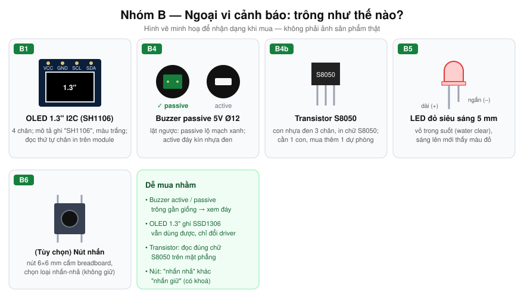
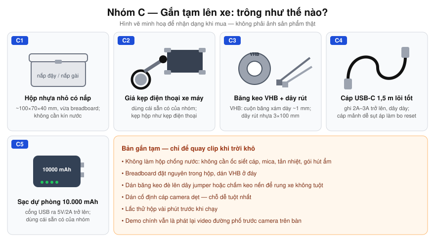
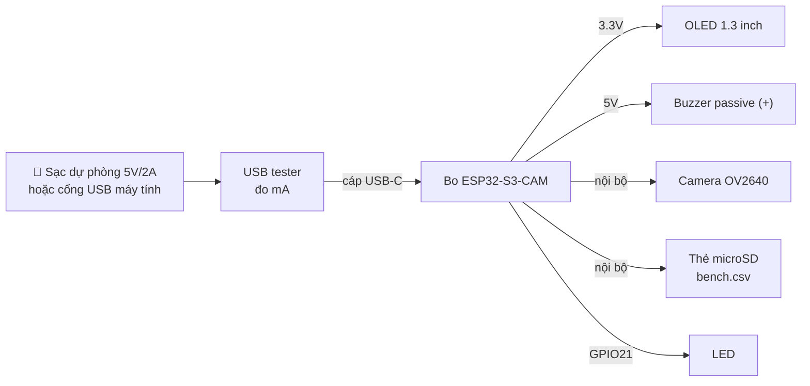

# [D1] BOM & Thông số phần cứng — ESP32-S3-CAM N16R8

* **Phụ trách kỹ thuật phần cứng:** Vũ Văn Duy (`26410031`) — Kỹ sư Nhúng & Thực nghiệm
* **Rà soát & Tinh gọn:** Trần Hoàng Hôn (`26410046`) — Trưởng nhóm / PM & QA *(Đã rà soát & chốt ngày 19/11/2026)*
* **Trạng thái:** 🟢 **ĐÃ CHỐT TINH GỌN (Chốt mua 1 bo, Breadboard 830 lỗ, tụ lọc nguồn — Sẵn sàng đặt hàng Tuần 5)**
* **Mở khóa cho:** `[H2]/[H4]` Hôn (tích hợp driver OLED/Buzzer/LED), `[S3]/[S4]` Sơn (ngân sách bộ nhớ và C-array header), `[D3]/[D4]` Duy (lắp ráp breadboard và đo đạc thực tế)

> Giá trong tài liệu là **ước tính tham khảo thực tế** (tháng 11/2026 trên Shopee / Lazada); kiểm tra lại trước khi đặt. Đã tối ưu ngân sách để mỗi thành viên chỉ đóng khoảng **80.000 – 95.000 ₫**.

---

## 1. Chọn bo mạch

**Chốt:** bo **"ESP32-S3-CAM N16R8"** (module `ESP32-S3-WROOM-1-N16R8`, camera `OV2640`, 2 cổng Type-C), loại có **sơ đồ chân camera tương thích Freenove ESP32-S3-WROOM CAM**.

| Tiêu chí | ESP32-S3-CAM N16R8 (Freenove/clone) ⭐ | Seeed XIAO ESP32S3 Sense | ESP32-CAM (AI-Thinker, chip cũ) |
|---|---|---|---|
| Flash / PSRAM | **16 MB / 8 MB Octal** | 8 MB / 8 MB | 4 MB / 4 MB |
| Tăng tốc AI (vector) | Có (LX7) | Có (LX7) | **Không** (LX6) → loại |
| Chân trống cho OLED/Buzzer/LED | Nhiều | Rất ít | Rất ít |
| USB nạp code | Có sẵn (Type-C) | Có | Cần đế MB |
| Giá ước tính | ~150–350k ₫ | ~400–600k ₫ | ~120k ₫ |

**Khi mua, kiểm tra trong ảnh/mô tả sản phẩm:**
- Tên module in trên vỏ kim loại: **`ESP32-S3-WROOM-1` … `N16R8`** (không mua N8R2, N4, hoặc "ESP32-CAM" đời cũ).
- Kèm camera **OV2640 góc thường (~66°)**. **Không** chọn ống kính góc rộng 120–160°: biển báo ở xa sẽ còn vài pixel, mô hình khó nhận.
- Bo có 2 cổng Type-C (một cổng USB-OTG, một cổng UART/CH340) → dễ nạp và xem log.

### 1.1 Nơi mua tham khảo (xem ảnh thật của bo tại link shop)

| Shop | Sản phẩm | Giá (xem ngày 18/11/2026) | Ghi chú |
|---|---|---:|---|
| [Điện tử Đức Huy](https://dientuduchuy.com/products/esp32-s3-n16r8-esp32-s3-cam-wifi-tich-hop-camera-bao-gom-ov2640) | ESP32-S3 WROOM N16R8 + OV2640 | 300.000 ₫ | Ghi rõ 2 cổng USB-C, Flash 16 MB + PSRAM 8 MB, khe SD, LED RGB. **Đang hết hàng** |
| [Điện tử Tuyết Nga](https://dientutuyetnga.com/products/esp32-cam-kit-phat-trien-esp32-s3-n16r8-ov2640-typec) | ESP32-S3 N16R8 + OV2640 Type-C | 205.000 ₫ | Trang không ghi số cổng USB-C và tồn kho; shop có ghi chú thông số có thể chưa cập nhật → hỏi shop trước khi đặt |
| Shopee / Lazada | "ESP32-S3-CAM N16R8" | ~75–350k ₫ | Có bản đi kèm **OV5640** (5MP) — xem ghi chú dưới |

**OV2640 hay OV5640?** Cả hai cắm chung một cổng camera và thư viện `esp32-camera` tự nhận loại cảm biến, nên firmware không cần sửa. Nhưng model AI chỉ nhìn ảnh 160×160, nên độ phân giải 5MP của OV5640 không giúp gì, lại tốn điện và nóng hơn. → **Chọn OV2640** nếu có; chỉ lấy OV5640 khi shop hết bản OV2640.

Không shop nào ở trên ghi sơ đồ chân camera, nên vẫn phải kiểm tra bằng firmware `mock_inference_test` khi nhận hàng (Mục 6).

👉 **Chốt mua 1 bo:** Hệ thống chỉ cần duy nhất **1 bo ESP32-S3-CAM N16R8** là hoạt động đầy đủ 100% tính năng (chụp ảnh, chạy AI INT8, OLED, còi PWM, log thẻ nhớ). Việc chốt 1 bo giúp tiết kiệm ngay ~200k–250k cho nhóm. Để an toàn, luôn rút cáp USB Type-C ra trước khi cắm/rút dây trên breadboard; chỉ mua thêm bo thứ 2 nếu nhóm còn dư dả quỹ.

⚠️ **Lưu trữ dữ liệu:** Tuyệt đối **không dùng ổ cứng di động / USB ngoài** vì ổ cứng ăn dòng lớn (0.5A–1A) gây sụt áp sập nguồn chip (`Brownout Crash`) và làm nặng firmware. Sử dụng khe cắm thẻ MicroSD có sẵn trên bo (chỉ ăn dòng 15–30mA) hoặc tận dụng luôn **bộ nhớ Flash 16MB có sẵn của chip (qua thư viện `LittleFS`)** để ghi file `bench.csv` hoàn toàn miễn phí.

---

## 2. BOM — danh sách mua

**Hướng đã chốt: bản tối giản trên breadboard.** Nhóm tập trung vào phần thầy chấm nặng nhất — **tối ưu mô hình và đo trên chip** — nên giảm tối đa phần lắp ráp: không làm hộp chống nước, không motor rung. Thiết bị chỉ gắn tạm lên xe để quay clip ngắn khi trời khô; demo chính là phát lại video đường phố trước camera đặt trên bàn (xem [Mục 5](#5-lắp-tạm-và-cách-demo)).

Chia 4 nhóm: **A–B mua ngay** (test trên bàn Tuần 5–6), **C mua khi gắn tạm lên xe** (cuối Tuần 7), **D là dụng cụ đo** (mượn được thì mượn).

### A. Mạch chính

| # | Linh kiện | SL | Ghi chú chọn mua | Giá ước tính |
|---|---|:---:|---|---:|
| A1 | Bo ESP32-S3-CAM N16R8 + OV2640 | 1 | Như Mục 1 (1 bo chạy toàn bộ đồ án; chỉ mua thêm bo 2 dự phòng nếu dư quỹ) | 200–280k |

### B. Ngoại vi cảnh báo

| # | Linh kiện | SL | Ghi chú chọn mua | Giá ước tính |
|---|---|:---:|---|---:|
| B1 | **OLED 1.3" I2C 128×64, chip SH1106, màu trắng** | 1 | Loại **4 chân I2C** (không lấy SPI 7 chân). Chọn **màu trắng một màu** — sáng và tương phản tốt hơn loại 2 màu vàng/xanh. ⚠️ Đọc thứ tự chân in trên module trước khi cắm (`VCC GND SCL SDA` hoặc `GND VCC SCL SDA`) | 80–100k |
| B4 | **Buzzer passive 5V** Ø12 mm | 1–2 | Còi thụ động phát xung PWM đa âm điệu (cấm: dồn dập; cảnh báo: ngắt quãng; hiệu lệnh: 1 bíp). ⚠️ **Không mua Active Buzzer** vì chỉ kêu được 1 tiếng đơn điệu | 5–10k |
| B4b | Transistor NPN **S8050** + điện trở 1kΩ | 1–2 | Mạch đệm kích dòng từ GPIO 3.3V điều khiển còi 5V | 5k |
| B5 | **LED đỏ siêu sáng 5mm** + điện trở 220–330Ω | 2–5 | Cảnh báo thị giác chớp nháy khi đi đường ồn ào | 5k |
| B6 | *(Tùy chọn)* Nút nhấn mini 6×6 mm | 1 | Nút Mute ngắt cảnh báo âm thanh (nối GPIO47) | 5k |

<b>Từ khoá tìm trên Shopee — nhóm B</b> (bấm để mở)

| # | Từ khoá | Tìm nhanh |
|---|---|---|
| B1 | `oled 1.3 inch i2c sh1106 trang` | [Shopee](https://shopee.vn/search?keyword=oled%201.3%20inch%20i2c%20sh1106) |
| B4 | `buzzer thu dong 5v passive 12mm` | [Shopee](https://shopee.vn/search?keyword=buzzer%20passive%205v%2012mm) |
| B4b | `transistor s8050 to92` | [Shopee](https://shopee.vn/search?keyword=transistor%20s8050) |
| B5 | `led do sieu sang 5mm trong suot` | [Shopee](https://shopee.vn/search?keyword=led%20do%20sieu%20sang%205mm) |
| B6 | `nut nhan 6x6` | [Shopee](https://shopee.vn/search?keyword=nut%20nhan%206x6) |

### C. Gắn tạm lên xe (để dành Tuần 7 — chưa cần mua ở Tuần 5)

| # | Linh kiện | SL | Ghi chú chọn mua | Giá ước tính |
|---|---|:---:|---|---:|
| C1 | **Hộp nhựa nhỏ có nắp** (~100×70×40 mm) | 1 | Che bụi khi gắn tạm lên xe Tuần 7 — **không cần kín nước** | 15–30k *(hoặc tận dụng hộp cũ)* |
| C2 | Giá kẹp điện thoại xe máy | 1 | **Dùng đồ có sẵn** của thành viên trong nhóm | (có sẵn) |
| C3 | Băng keo **3M VHB** 2 mặt + dây rút nhựa | 1 | Cố định mạch và dây cáp dọc ghi-đông | 20–30k |
| C4 | Cáp USB-C **1,5 m lõi tốt** (ghi 2A–3A) | 1 | Cáp lõi tốt tránh sụt áp gây reset bo | 40–60k *(hoặc dùng cáp có sẵn)* |
| C5 | Sạc dự phòng 10.000 mAh, 5V/2A | 1 | Cấp nguồn độc lập, dùng đồ sẵn có | (có sẵn) |

<b>Từ khoá tìm trên Shopee — nhóm C</b> (bấm để mở)

| # | Từ khoá | Tìm nhanh |
|---|---|---|
| C1 | `hop nhua linh kien co nap 100x70` | [Shopee](https://shopee.vn/search?keyword=hop%20nhua%20linh%20kien%20co%20nap) |
| C3 | `bang keo 3m vhb` · `day rut nhua` | [Shopee](https://shopee.vn/search?keyword=bang%20keo%203m%20vhb) |
| C4 | `cap usb type c 1.5m 3a` | [Shopee](https://shopee.vn/search?keyword=cap%20usb%20type%20c%201.5m%203a) |

### D. Đo đạc & dụng cụ thực nghiệm

| # | Linh kiện | SL | Ghi chú | Giá ước tính |
|---|---|:---:|---|---:|
| D1 | **USB tester** đo dòng/áp (KWS-V20) | 1 | Đo mA nộp báo cáo. **Ưu tiên mượn phòng Lab trường / bạn bè** | (mượn hoặc ~70k) |
| D2 | Thẻ **microSD 8–32 GB** | 1 | Ghi `/sdcard/bench.csv`. **Tận dụng thẻ cũ có sẵn** (hoặc dùng Flash 16MB LittleFS tiết kiệm 0₫) | (có sẵn hoặc ~40k) |
| D3 | **Breadboard 830 lỗ (loại dài)** + tép dây jumper Cái–Đực & Đực–Đực | 1 bộ | Bo ESP32-S3 to, dùng loại 830 lỗ để cắm thẳng bo mạch và ngoại vi gọn gàng | 40–50k |
| D3b | **Tụ hóa $100\mu\text{F} - 470\mu\text{F}$ 16V** | 1–2 | Cắm song song 5V–GND chống sụt áp Brownout khi camera chụp | 2k |
| D4 | Cáp Type-C **có truyền dữ liệu** | 1 | Nạp code qua cổng UART/USB | (dùng cáp sẵn có) |
| D5 | Súng bắn keo nến | — | Cố định chân cắm khi gắn xe Tuần 7 | (mượn) |

**Tổng chi phí thực tế cần chi ở Tuần 5:** chỉ khoảng **380.000 – 480.000 ₫** (mỗi thành viên đóng khoảng **80.000 – 95.000 ₫**, giảm hơn một nửa so với dự toán ban đầu mà vẫn đảm bảo 100% đầy đủ chức năng và số liệu thực nghiệm).

---

## 3. Bảng chân (Pinout) — `ESP32-S3-CAM N16R8` (sơ đồ Freenove)

### 3.1 Chân ĐÃ BẬN — không được đấu thêm

| Nhóm | GPIO |
|---|---|
| Camera OV2640 | XCLK `15`, SIOD (SDA) `4`, SIOC (SCL) `5`, Y2–Y9 = `11, 9, 8, 10, 12, 18, 17, 16`, VSYNC `6`, HREF `7`, PCLK `13` |
| Flash SPI (bên trong module) | `26–32` |
| Octal PSRAM (bên trong module) | `33–37` |
| Thẻ microSD (SDMMC 1-bit) | `38, 39, 40` |
| USB nạp code / log | `19, 20` (USB D−/D+), `43, 44` (UART0 TX/RX) |
| Strapping (ảnh hưởng chế độ boot) | `0` (nút BOOT), `3`, `45`, `46` — tránh dùng |

### 3.2 Chân ĐỀ XUẤT cho ngoại vi (`[H2]`)

| Ngoại vi | GPIO | Cách đấu |
|---|:---:|---|
| OLED 1.3" SDA | `41` | Nối SDA của OLED |
| OLED 1.3" SCL | `42` | Nối SCL của OLED |
| OLED 1.3" VCC / GND | `3V3` / `GND` | Cấp 3.3V. **Đọc thứ tự chân in trên module** — loại 1.3" thường là `VCC GND SCL SDA` |
| Buzzer passive (qua S8050) | `14` | GPIO14 (xuất xung PWM để tạo tiếng) → R 1kΩ → B của S8050; E → GND; C → chân (−) buzzer; chân (+) buzzer → `5V` |
| LED cảnh báo | `21` | GPIO21 → R 330Ω → LED (+); LED (−) → GND |
| Nút nhấn (tùy chọn: tắt cảnh báo) | `47` | Nút nối GPIO47 ↔ GND, bật pull-up nội |

**Đọc sơ đồ:** mỗi đường màu là một sợi dây jumper. Ký hiệu ⏚ nghĩa là nối về chân `GND` của bo (trên breadboard: cắm chung vào hàng `−`). Buzzer không cắm thẳng vào GPIO vì chân GPIO chỉ ra 3.3V và chịu dòng nhỏ; transistor S8050 làm "công tắc điện tử": GPIO14 bật nhẹ chân B → dòng 5V chạy qua buzzer.

> ℹ️ **Ghi chú cho Hôn (`[H2]`):** OLED 1.3" dùng chip **SH1106**, không phải SSD1306. Trong thư viện (U8g2 / Adafruit), chọn driver SH1106 128×64 — nếu dùng nhầm driver SSD1306, hình sẽ bị lệch 2 cột và có viền nhiễu bên phải. Địa chỉ I2C thường là `0x3C`.
>
> ⚠️ Trên một số bo clone, `GPIO2` (LED onboard) hoặc `GPIO48` (LED RGB) đã dùng sẵn — vì vậy không dùng 2 chân này.
> ⚠️ **Bắt buộc kiểm tra lại** bảng 3.1 với sơ đồ in trên bo / trang sản phẩm khi nhận hàng. Cách nhanh nhất: nạp `mock_inference_test` — nếu camera khởi tạo thành công thì sơ đồ Freenove là đúng.

### 3.3 Sơ đồ khối nguồn

*Mọi linh kiện dùng **chung GND** với bo. Không lấy điện ắc-quy xe — chỉ dùng nguồn 5V qua USB.*

---

## 4. Ngân sách bộ nhớ (gửi Sơn cho `[S1]/[S2]`)

| Tài nguyên | Tổng | Dự kiến dùng | Còn cho model |
|---|---:|---|---|
| Flash | 16 MB | Firmware ~1–1.5 MB | **Model `.tflite` nên ≤ 2–3 MB** (lý tưởng < 1.5 MB như đề cương) |
| PSRAM (Octal) | 8 MB | Frame buffer camera ×2 (~300 KB) | **Tensor Arena có thể vài MB**, nhưng chậm hơn SRAM trong |
| SRAM trong | 512 KB | Hệ thống + Wi-Fi tắt | Arena đặt trong SRAM nhanh hơn nếu < ~250 KB |

👉 Số liệu thật (arena đã dùng, thời gian `Invoke()`) sẽ lấy từ `[D2]` → `mock_inference_test/`.

---

## 5. Lắp tạm và cách demo

**Phạm vi:** không làm bản gắn xe chống nước. Thiết bị chạy chính trên bàn để đo; chỉ gắn tạm lên xe **khi trời khô, cuối Tuần 7**, để quay một clip ngắn minh hoạ. Các tình huống về **nhận diện** (biển ở xa, báo nhầm, ngược sáng…) và cách đo nằm ở [tinh_huong_thuc_te_va_tieu_chi_danh_gia.md](../06_reports_slides/tinh_huong_thuc_te_va_tieu_chi_danh_gia.md).

### 5.1 Demo chính: phát lại video đường phố trước camera

1. Một người lái xe, một người ngồi sau cầm **điện thoại quay video** các tuyến đường TP.HCM có biển trong 12 lớp (ban ngày, ngược sáng, chiều tối, sau mưa).
2. Trên bàn: đặt bo ESP32-S3 cố định, camera hướng vào màn hình laptop/màn hình lớn đang **phát lại video** đó.
3. Thiết bị nhận diện và cảnh báo trên OLED + LED + buzzer như khi chạy thật. Quay lại cảnh này để đưa vào slide.

Cách này lặp lại được nhiều lần với cùng một video, nên so sánh được các model (FP32 / INT8 / pruned) trong **cùng điều kiện**. Lưu ý khi đánh giá: màn hình có độ sáng và độ nhoè khác cảnh thật, nên ghi rõ đây là phát lại.

### 5.2 Gắn tạm lên xe (cuối Tuần 7, trời khô)

1. Đặt **breadboard đã cắm sẵn mạch** vào hộp nhựa (C1), dán đáy bằng băng keo VHB.
2. Dán băng keo đè lên các dây jumper, hoặc **chấm keo nến** ở chân dây, để rung xe không làm tuột dây.
3. **Dán cố định cáp camera** (cáp dẹt dễ tuột nhất), hướng camera ra trước và lệch phải khoảng 10–15°.
4. Khoét lỗ nhỏ trên nắp/hông hộp cho camera nhìn ra và cho OLED nhìn thấy được.
5. Kẹp hộp vào giá kẹp điện thoại có sẵn; đi cáp USB dọc ghi-đông bằng dây rút, **không vướng tay phanh, tay ga, không bị kéo căng khi đánh lái hết cỡ**.
6. **Lắc thử hộp vài phút** trước khi chạy: log không reset, camera không tuột, dây không lỏng.
7. Chạy ở đường vắng, tốc độ thấp, **hai người**: người lái chỉ tập trung lái, người ngồi sau quay video và theo dõi.

## 6. Checklist khi nhận hàng

- [ ] Đọc đúng chữ `N16R8` trên module.
- [ ] Cắm cáp → máy tính nhận cổng COM (macOS: `/dev/cu.usbserial-*` hoặc `/dev/cu.usbmodem*`).
- [ ] Nạp `mock_inference_test` → log báo **PSRAM 8 MB** và **Flash 16 MB**.
- [ ] Log báo **camera init OK** và đo được thời gian chụp 1 frame.
- [ ] Đo dòng tiêu thụ không tải bằng USB tester (ghi vào bảng đo).
- [ ] OLED 1.3": đọc thứ tự chân in trên module (`VCC GND SCL SDA` hay `GND VCC SCL SDA`) trước khi cắm; ghi lại cho Hôn.
- [ ] Buzzer passive: phát thử 2 kiểu tiếng (1 tiếng / dồn dập), âm lượng không làm phiền người đứng cạnh.
- [ ] Gửi bảng pinout đã xác nhận cho Hôn.

## 7. Bổ sung ảnh thực tế (nhóm tự chụp)

Ảnh trên trang shop thuộc bản quyền của shop/nhà cung cấp, nên **không chép vào repo** (repo công khai trên GitHub và ảnh sẽ dùng lại trong báo cáo). Thay vào đó, khi nhận hàng hãy tự chụp và lưu vào `05_firmware_esp32s3/images/photos/`. Ảnh tự chụp còn dùng được thẳng cho báo cáo và slide.

| File cần chụp | Nội dung |
|---|---|
| `photos/01_board_top.jpg` | Mặt trên bo, đọc rõ chữ `N16R8` trên module |
| `photos/02_board_pins.jpg` | Cận cảnh 2 hàng chân có in số GPIO (để đối chiếu Mục 3) |
| `photos/03_breadboard_wiring.jpg` | Mạch đã cắm trên breadboard theo sơ đồ Mục 3.2 |
| `photos/04_serial_log.png` | Ảnh chụp màn hình log `mock_inference_test` |
| `photos/05_bench_setup.jpg` | Bo trên bàn hướng vào màn hình phát video (demo chính, Mục 5.1) |
| `photos/06_bench_csv.png` | Mở file `bench.csv` từ thẻ microSD (bằng Excel / Google Sheets) |
| `photos/07_temp_mount.jpg` | Hộp gắn tạm trên giá kẹp xe (Mục 5.2) |

**Thẻ microSD:** firmware `mock_inference_test` đã ghi toàn bộ số liệu đo ra `/sdcard/bench.csv` (các dòng `CSV,...`). Sau mỗi lần chạy, rút thẻ, chép file về máy và lưu cùng ngày đo — đây là bằng chứng số liệu cho Chương 4 của báo cáo.

Mẹo: thu nhỏ ảnh còn khoảng 1600 px chiều ngang trước khi commit để repo nhẹ.

## 8. Trạng thái đặt hàng

| Ngày | Danh mục linh kiện | Người phụ trách | Giá ước tính | Trạng thái & Ghi chú |
|---|---|:---:|---:|---|
| **19/11/2026** | **Trọn bộ linh kiện tinh gọn Tuần 5:** • 1 Bo ESP32-S3-CAM N16R8 (Cam OV2640 góc 66°) • 1 Màn hình OLED 1.3" I2C SH1106 trắng • Còi Passive Buzzer 5V + Transistor S8050 • LED đỏ 5mm, điện trở 220Ω, nút nhấn Mute • Breadboard 830 lỗ (loại dài) + tép dây Cái-Đực • 1 Tụ hóa lọc nguồn 220uF–470uF 16V | **Vũ Văn Duy** (`[D3]`) | **~380.000 – 450.000 ₫** | 🟢 **ĐÃ RÀ SOÁT & DUYỆT CHỐT** Trưởng nhóm Trần Hoàng Hôn đã rà soát lại và chốt danh mục tinh gọn. Duy tiến hành đặt hàng Shopee ngay để kịp nhận linh kiện chạy thực nghiệm Tuần 5. |
