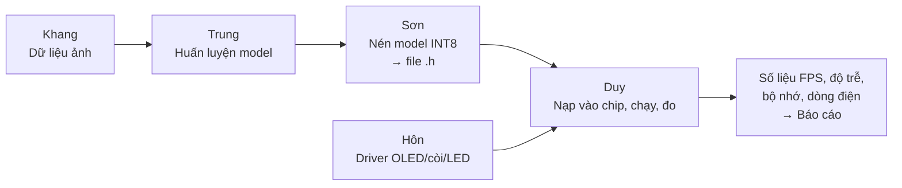

# Giải thích phần việc của Duy (`[D1]`–`[D4]`) — để báo cáo với Thầy

* **Người phụ trách:** Vũ Văn Duy (`26410031`) — Kỹ sư Nhúng & Thực nghiệm
* **Đọc trong 10 phút.** Mỗi mục: *làm gì → vì sao → đang ở đâu*. Cuối file có các câu Thầy hay hỏi và bảng thuật ngữ.
* Cập nhật: 24/11/2026.

---

## 1. Tóm tắt 30 giây (nói khi Thầy hỏi "em làm gì?")

> Em phụ trách **phần cứng và phần mềm chạy trên chip**. Em chọn bo ESP32-S3 N16R8 có camera, lên danh sách linh kiện và sơ đồ đấu dây. Em viết 2 chương trình cho chip:
> 1. **Chương trình đo** (`mock_inference_test`): đo chip chạy model AI nhanh cỡ nào, tốn bao nhiêu bộ nhớ, bao nhiêu điện, chạy 30 phút có ổn định không — để có số liệu thật cho báo cáo.
> 2. **Chương trình cảnh báo** (`traffic_sign_alert`): camera nhìn biển báo → model AI nhận ra biển gì → hiện lên màn hình OLED, nháy đèn, kêu còi; có chống báo nhầm và tự báo khi camera bị che.
>
> Cả hai đã **build thành công**, phần logic cảnh báo đã **kiểm thử và mô phỏng trên máy tính đạt**. Linh kiện đã đặt, **chưa chạy trên bo thật** — bước tiếp theo khi hàng về là lắp mạch (`[D3]`) và nạp model thật của Sơn để đo (`[D4]`).

---

## 2. Bức tranh tổng thể — phần của em nằm ở đâu



Em là **khâu cuối**: model của cả nhóm chỉ có ý nghĩa khi chạy được trên chip thật với tốc độ đủ nhanh. Số liệu em đo là bằng chứng cho phần "Edge AI / TinyML" của đề tài.

---

## 3. `[D1]` Phần cứng — chọn gì, vì sao

File: [`bom_and_hardware_specs.md`](bom_and_hardware_specs.md)

### 3.1 Bo mạch ESP32-S3-CAM N16R8

So với máy tính cho dễ hình dung:

| Trên chip | Giống trên PC | Dung lượng | Dùng để |
|---|---|---|---|
| **Flash** | Ổ SSD | **16 MB** ("N16") | Chứa chương trình + model AI |
| **PSRAM** | RAM, nhưng chậm hơn | **8 MB** ("R8") | Chứa ảnh camera (mỗi ảnh VGA ~600 KB) |
| **SRAM** | Cache CPU — nhỏ mà rất nhanh | 512 KB | Vùng làm việc của model nếu vừa |
| CPU | 2 nhân 240 MHz | — | Có lệnh tăng tốc tính toán AI (vector) |

**Vì sao chọn bo này:**
- ESP32-**S3** có lệnh tăng tốc AI; ESP32-CAM đời cũ (chip ESP32 thường) không có và chỉ 4 MB → loại.
- 8 MB PSRAM đủ chứa 2 ảnh camera cùng lúc (một ảnh đang chụp, một ảnh đang xử lý).
- Có sẵn khe camera, khe thẻ nhớ, 2 cổng USB-C, còn nhiều chân trống cho màn hình/còi/đèn. Giá ~200k.

**Camera:** OV2640 hoặc OV3660 đều dùng được (firmware tự nhận loại, tự lật ảnh nếu bị ngược). Chọn **ống kính thường ~66°**, không lấy góc rộng — góc rộng làm biển ở xa bé xíu, model không đọc được.

### 3.2 Linh kiện cảnh báo

| Linh kiện | Vì sao |
|---|---|
| OLED 1.3" I2C, chip SH1106, trắng | Hiện được icon biển + chữ; 0.96" quá nhỏ khi đi xe. Chữ trắng nền đen dễ đọc ngoài trời |
| Còi **passive** + transistor S8050 | Passive phát được nhiều kiểu tiếng (biển cấm kêu dồn dập, biển thường 1 tiếng). Chân chip chỉ ra 3.3V, dòng nhỏ → transistor làm "công tắc" để chip bật còi 5V |
| LED đỏ siêu sáng | Kênh cảnh báo chính cùng OLED — khi gió to, đội mũ bảo hiểm thì khó nghe còi |
| Nút nhấn | Tắt/bật tiếng còi |
| Tụ hoá 470µF | Như "bình chứa điện" nhỏ: lúc camera + AI chạy cùng lúc, chip hút điện đột ngột → tụ bù vào, tránh bo tự reset |

### 3.3 Chọn chân (pinout)

Chip có ~45 chân nhưng **nhiều chân đã bận**: camera chiếm 13 chân, bộ nhớ trong chiếm `GPIO 26–37`, thẻ nhớ 3 chân, USB 4 chân. Em chọn chân còn trống: **OLED 41/42, còi 14, LED 21, nút 47**. Quan trọng nhất: **né `GPIO 33–37`** — đó là chân nối với PSRAM bên trong, cắm vào là bo treo.

### 3.4 Chi phí

Nhóm chốt bản tinh gọn: 1 bo + breadboard 830 lỗ, tổng **~380–450k**, mỗi người ~80–95k. Không làm hộp chống nước; demo chính là **phát video đường phố trước camera đặt trên bàn**, chỉ gắn tạm lên xe quay clip khi trời khô (Tuần 7).

---

## 4. `[D2]` Chương trình đo — `mock_inference_test`

File: [`mock_inference_test/`](mock_inference_test/README.md)

Giống chạy **benchmark cho PC** (CrystalDiskMark, 3DMark, burn-in test), nhưng cho chip. Nạp vào là tự chạy lần lượt:

| Bước | Đo gì | Giống trên PC |
|---|---|---|
| `hw` | Có đúng 16 MB Flash / 8 MB PSRAM không, RAM còn trống, nhiệt độ chip | Xem thông số trong CPU-Z |
| `sd` | Tốc độ ghi thẻ nhớ | CrystalDiskMark |
| `model` | Mỗi model: tốn bao nhiêu RAM, chạy 1 lần mất bao nhiêu ms — so sánh đặt trong **PSRAM** và **SRAM** | Benchmark game ở RAM chậm vs nhanh |
| `camera` | Chụp 1 ảnh mất bao lâu (QVGA 320×240 và VGA 640×480) | — |
| `pipeline` | Cả dây chuyền: chụp → cắt ảnh → AI → kết quả, đo từng khâu | Đo độ trễ end-to-end |
| `soak` | Chạy liên tục **30 phút**: FPS, nhiệt độ, lỗi; lúc này đọc dòng điện (mA) trên USB tester | Burn-in test |

Số liệu in ra dạng `CSV,...` và ghi vào thẻ nhớ `bench.csv`. Script [`tools/bench_report.py`](tools/bench_report.py) đổi file đó thành **bảng + biểu đồ** dán thẳng vào báo cáo.

**Hiện tại dùng model "mock"** (model giả của nhóm, đoán ngẫu nhiên) — chỉ để chứng minh cả dây chuyền chạy thông. Khi Sơn xuất model thật (`traffic_sign_model_int8.h`), chỉ cần khai báo thêm 1 dòng trong `models.h` là đo được model thật.

### Vì sao cắt vùng góc trên-phải (ROI) thay vì dùng cả ảnh

Model chỉ nhận ảnh nhỏ 160×160. Nếu thu nhỏ cả khung hình, biển cách 15 m chỉ còn **~6 pixel** — không đọc được. Biển báo ở Việt Nam đặt **lề phải, phía trên**, nên em **cắt đúng ô 160×160 ở góc đó** từ ảnh VGA → biển ở 15 m còn **~26 pixel**, nhận được từ khoảng **20 m**. Ở 40 km/h (≈11 m/giây) như vậy người lái còn ~1,5 giây để phản ứng. Chương trình đo so sánh 4 cách (A/B/C/C2) để chọn cách tốt nhất bằng số liệu thật.

---

## 5. Chương trình cảnh báo — `traffic_sign_alert`

File: [`traffic_sign_alert/`](traffic_sign_alert/README.md) — đây là chương trình chạy khi **demo**.

```
Camera → kiểm tra camera bị che → cắt ô 160×160 góc trên-phải → model AI
       → quy tắc chống báo nhầm → OLED + LED + còi
```

- **Chia 2 nhân CPU:** nhân 1 chỉ lo nhận diện; nhân 0 lo màn hình, đèn, còi. Giống PC đa nhân: còi đang kêu không làm chậm nhận diện.
- **Dùng lại code của bạn khác, không chép:** driver OLED/còi/LED/icon 12 biển của Hôn, bảng chân và danh sách model dùng chung với chương trình đo.
- **Chống báo nhầm** (tình huống T9 trong [file tình huống](../06_reports_slides/tinh_huong_thuc_te_va_tieu_chi_danh_gia.md)):
  1. Cùng một biển phải thấy **3 khung hình liên tiếp**, độ tin cậy **≥ 0,6** mới báo → loại nhiễu thoáng qua.
  2. Biển còn trong khung hình thì **không báo lại**; cùng biển đó **10 giây** sau mới được báo lại.
- **Kiểu báo:** biển cấm / đi chậm → LED nháy 3 lần + 3 tiếng bíp dồn dập; biển khác → 1 nhịp. OLED hiện icon + tên biển 3 giây.
- **Nhớ biển tốc độ:** gặp biển 50 thì màn hình chờ hiện "giới hạn 50" đến khi gặp biển tốc độ khác.
- **Camera bị che** (T8 — áo mưa, tay, bụi): chương trình đo độ sáng và độ nét của ảnh; tối/mờ liên tục 2 giây → OLED hiện "CAMERA BI CHE", LED sáng liên tục, tạm ngừng nhận diện. Ảnh tốt lại 1 giây thì tự trở lại. Không im lặng như thể "không có biển".
- **Nút nhấn:** tắt/bật tiếng còi.
- **Tự kiểm tra lúc khởi động:** in loại camera thật (`CSV,sensor`) và quét I2C tìm màn hình OLED ở địa chỉ `0x3C` (`CSV,i2c`) — dùng cho nghiệm thu `[D3]`.

Các con số 3 khung / 0,6 / 10 giây / ngưỡng tối-mờ là **giá trị khởi đầu**, sẽ chỉnh lại khi có bo và model thật.

---

## 6. Mô phỏng trong lúc chờ hàng

Camera không giả lập được, nên em viết một **kịch bản ~30 giây** ([`sim_scenario.h`](traffic_sign_alert/src/sim_scenario.h)) thay cho camera: lúc nào đường trống, lúc nào thấy biển gì với độ tin cậy bao nhiêu, lúc nào lấy tay che camera. Mọi phần còn lại chạy **đúng code thật**.

| Cách | Xem được gì | Trạng thái |
|---|---|---|
| Chạy trên máy tính (`host_tests/sim_run.cpp`) | Dòng thời gian: giây thứ mấy báo biển gì, LED/còi làm gì; tự kiểm tra kết quả | ✅ Chạy được, **đúng 4/4 lần cảnh báo + 1 lần báo che camera** như mong đợi |
| Wokwi trong VS Code | Màn OLED, LED, còi nhấp nháy như thật trên sơ đồ mạch | Build thành công, cần cài extension Wokwi để chạy |
| Kiểm thử logic (`host_tests/test_logic.cpp`) | 10 bài kiểm thử cho quy tắc chống báo nhầm và phát hiện che camera | ✅ Đạt 10/10 |

Kịch bản mô phỏng kiểm tra đúng các tình huống: biển thoáng qua 2 khung (không báo), điểm thấp 0,45 (không báo), biển cấm thật (báo 1 lần), gặp lại sau 1 giây (không báo lại), biển tốc độ 50 (báo + nhớ), đi chậm (báo mức cao), che camera 3,5 giây (báo che sau 2 giây), biển tốc độ 40 (đổi số nhớ).

---

## 7. Công cụ phụ

- [`pio.sh`](pio.sh): công cụ build của Espressif (ESP-IDF) **không chịu đường dẫn có dấu cách** — mà thư mục môn học có dấu cách và tiếng Việt. Script chép code sang `~/ce340-build` (không dấu) rồi build ở đó; code vẫn sửa và commit trong repo như bình thường.
- [`tools/bench_report.py`](tools/bench_report.py): đổi số liệu đo thành bảng Markdown và biểu đồ cho Chương 4.

---

## 8. Đang ở đâu — nói thật với Thầy

| Hạng mục | Trạng thái |
|---|---|
| Chọn bo, danh sách linh kiện, sơ đồ chân `[D1]` | ✅ Xong, trưởng nhóm đã duyệt 19/11, **đã đặt hàng 20/11** |
| Chương trình đo `[D2]` | ✅ Build thành công (Flash ~650 KB / 6 MB) — **chưa chạy trên bo thật** |
| Chương trình cảnh báo | ✅ Build thành công (RAM 8,9%, Flash ~592 KB) — logic đạt 10/10 kiểm thử + mô phỏng đúng kịch bản — **chưa chạy trên bo thật** |
| Chuẩn bị nạp model thật `[D4]` | ✅ Firmware tự nhận model **classifier** hoặc **MobileNetV2-SSD** (giải mã SSD ngay trên chip, anchor giống hệt code Python của Trung) và tự dùng file model của Sơn khi có. Kiểm thử 16/16 so với code Python. Build với model SSD 160 (2,9 MB): Flash 3,5 MB / 6 MB. Phát hiện script lượng tử hoá phải export **batch = 1**, nếu không TFLite Micro không chạy được model |
| Lắp mạch, smoke test `[D3]` | ⏳ Chờ linh kiện về |
| Nạp model thật, đo FPS/độ trễ/mA `[D4]` | ⏳ Chờ linh kiện + file model `.h` của Sơn `[S4]` |

**Chưa có số liệu đo thật nào** (FPS, độ trễ, mA). Mọi con số trong báo cáo về hiệu năng chip phải lấy từ lần chạy thật, không dùng số ước tính.

---

## 9. Câu Thầy có thể hỏi

**Sao không dùng Raspberry Pi / điện thoại cho dễ?**
Đề tài là AI trên hệ thống nhúng (TinyML): chạy model trên chip vài đô, ít điện (vài trăm mA ở 5V), không cần mạng. Raspberry Pi mạnh hơn nhiều nhưng tốn điện, đắt, và không còn là bài toán "tối ưu cho thiết bị nhỏ".

**INT8 / lượng tử hoá là gì, sao cần?**
Model gốc lưu số thực 32 bit. Đổi sang số nguyên 8 bit → nhỏ đi ~4 lần, chip tính nhanh hơn nhiều, độ chính xác giảm ít. Phần này Sơn làm; em đo xem trên chip thật nhanh hơn bao nhiêu.

**Tensor arena là gì?**
Vùng RAM model dùng để tính toán trung gian khi chạy. Nhỏ (< ~250 KB) thì đặt trong SRAM nhanh; lớn thì phải để trong PSRAM chậm hơn. Chương trình đo cả hai để so sánh.

**FPS bao nhiêu thì đủ?**
Cần 3 khung liên tiếp mới báo. Ở ~5 khung/giây mất ~0,6 giây ≈ 7 m đường ở 40 km/h. Muốn báo trước ≥ 1 giây thì phải thấy biển từ ~20 m → đó là lý do cắt ROI. Mục tiêu nhóm: 5–10 FPS với cách cắt ROI; số thật chờ đo.

**Lỡ báo nhầm liên tục thì sao?**
Quy tắc 3 khung + điểm ≥ 0,6 + mỗi biển 1 lần + chờ 10 giây. Khi demo bằng video, log `CSV,alert` ghi thời điểm mỗi lần báo để đếm báo đúng / báo nhầm / bỏ sót.

**Camera bị che (mưa, áo mưa) thì sao?**
Chương trình tự phát hiện ảnh quá tối hoặc quá mờ và báo "CAMERA BI CHE" thay vì im lặng.

**Đo dòng điện thế nào?**
Cắm USB tester giữa nguồn và bo, đọc mA trong lúc chương trình chạy liên tục 30 phút (bước `soak`).

**Sao chưa có số liệu thật?**
Linh kiện đặt 20/11, đang giao. Trong lúc chờ: đã build xong cả hai chương trình, kiểm thử logic và mô phỏng trên máy tính. Hàng về là nạp và đo ngay.

**Em dùng thư viện gì?**
ESP-IDF 5.3 (bộ công cụ chính thức của Espressif) qua PlatformIO; `esp-tflite-micro` để chạy model TensorFlow Lite trên chip; `esp32-camera` cho camera. Driver OLED/còi/LED do Hôn viết.

---

## 10. Thuật ngữ

| Từ | Nghĩa dễ hiểu |
|---|---|
| Firmware | Chương trình nạp vào chip (như hệ điều hành + phần mềm của một thiết bị nhỏ) |
| Build / nạp (flash) | Biên dịch code thành file chạy được / chép file đó vào chip qua cáp USB |
| GPIO | Chân tín hiệu của chip, dùng để nối linh kiện ngoài |
| I2C | Kiểu nối 2 dây (SDA, SCL) để chip nói chuyện với màn hình |
| PWM | Bật/tắt chân thật nhanh để tạo tiếng còi hoặc chỉnh độ sáng |
| FreeRTOS, task | Hệ điều hành mini trên chip; task = một "chương trình con" chạy song song |
| ROI | Vùng ảnh được cắt ra để đưa vào model (ở đây: góc trên-phải) |
| TFLite Micro | Bản thu nhỏ của TensorFlow Lite để chạy model trên vi điều khiển |
| Breadboard | Bảng cắm thử mạch, không cần hàn |
| Smoke test | Thử nhanh xem có chạy không (cắm điện không "bốc khói") |
| Soak test | Chạy liên tục thời gian dài để xem có lỗi, có nóng không |
