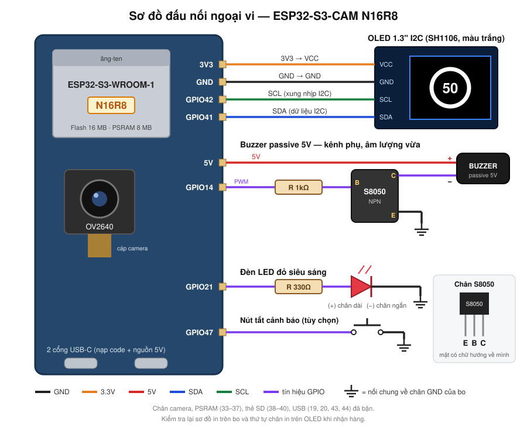

# `05_firmware_esp32s3/peripherals_test` — Kiểm thử Ngoại vi Ghi-đông (OLED, Buzzer, LED)

* **Phụ trách:** Trần Hoàng Hôn (`MSSV: 26410046`) — Trưởng nhóm / QA & Giao tiếp ngoại vi (`[H2]`)
* **Nền tảng:** `ESP32-S3-CAM N16R8` (`PlatformIO` + `ESP-IDF`) hoặc mô phỏng trực quan trên `Wokwi`
* **Mục tiêu:** Kiểm chứng toàn bộ khối cảnh báo HMI trên ghi-đông (màn hình hiển thị icon biển báo, còi bíp PWM, đèn LED chớp và nút bấm ngắt còi) độc lập trước khi ghép nối vào pipeline camera AI.

---

## 1. Sơ đồ Đấu nối Chân (Pinout)

> **Cảnh báo phần cứng:** Toàn bộ chân ngoại vi được chọn **né tuyệt đối các chân camera OV2640** và dải chân **`GPIO 33–37` của Octal PSRAM** trên module `ESP32-S3-WROOM-1 N16R8`.

| Ngoại vi | Linh kiện | Chân GPIO | Cách đấu nối & Nguyên lý |
| :--- | :--- | :---: | :--- |
| **Màn hình OLED** | 1.3" I2C SH1106 (128×64) | `SDA = 41`<br>`SCL = 42` | `VCC` $\rightarrow$ `3.3V`, `GND` $\rightarrow$ `GND`. I2C Address `0x3C`. Driver căn chuẩn offset 2 cột của chip SH1106 (không bị lệch viền phải như driver SSD1306). |
| **Còi cảnh báo** | Buzzer passive 5V (12mm) | `PWM = 14` | GPIO 14 xuất xung PWM `LEDC` $\rightarrow$ Trở $1\text{ k}\Omega$ $\rightarrow$ Chân B transistor **S8050**; Chân E $\rightarrow$ `GND`; Chân C $\rightarrow$ cực (−) còi; cực (+) còi $\rightarrow$ `5V`. |
| **Đèn LED đỏ** | LED siêu sáng 5mm | `LED = 21` | GPIO 21 $\rightarrow$ Trở $330\Omega$ $\rightarrow$ Anode (+); Cathode (−) $\rightarrow$ `GND`. |
| **Nút bấm** | Tact switch 6×6 | `BTN = 47` | Chân 1 $\rightarrow$ GPIO 47, Chân 2 $\rightarrow$ `GND` (sử dụng điện trở kéo lên nội bộ `GPIO_PULLUP_ENABLE`). |



---

## 2. Chính sách Cảnh báo & Mô phỏng 12 Biển báo

Chương trình tự động lặp qua 12 lớp biển báo trong [`01_dataset/classes.yaml`](../../01_dataset/classes.yaml):

| Class ID | Mã QCVN | Tên biển báo | Nhóm | Cấp độ | Hành vi LED | Hành vi Buzzer (LEDC PWM) |
| :---: | :--- | :--- | :---: | :---: | :---: | :--- |
| **0** | `P.102` | Cấm đi ngược chiều | Cấm | **High** | Chớp nhanh 3 nhịp | **3 tiếng bíp dồn dập** (2.7 kHz, 80ms on / 40ms off) |
| **1** | `P.123a` | Cấm rẽ trái | Cấm | **High** | Chớp nhanh 3 nhịp | **3 tiếng bíp dồn dập** (2.7 kHz) |
| **2** | `P.123b` | Cấm rẽ phải | Cấm | **High** | Chớp nhanh 3 nhịp | **3 tiếng bíp dồn dập** (2.7 kHz) |
| **3** | `P.124a` | Cấm quay đầu | Cấm | **High** | Chớp nhanh 3 nhịp | **3 tiếng bíp dồn dập** (2.7 kHz) |
| **4** | `P.104` | Cấm xe mô tô | Cấm | **High** | Chớp nhanh 3 nhịp | **3 tiếng bíp dồn dập** (2.7 kHz) |
| **5** | `R.301a` | Hướng đi thẳng | Hiệu lệnh | **Medium** | Sáng giữ 180ms | **1 tiếng bíp ngắn** (2.2 kHz, 120ms) |
| **6** | `R.303` | Vòng xuyến | Hiệu lệnh | **Medium** | Sáng giữ 180ms | **1 tiếng bíp ngắn** (2.2 kHz) |
| **7** | `P.127` | Tốc độ tối đa 40 | Tốc độ | **Medium** | Sáng giữ 180ms | **1 tiếng bíp ngắn** (2.2 kHz) |
| **8** | `P.127` | Tốc độ tối đa 50 | Tốc độ | **Medium** | Sáng giữ 180ms | **1 tiếng bíp ngắn** (2.2 kHz) |
| **9** | `P.127` | Tốc độ tối đa 60 | Tốc độ | **Medium** | Sáng giữ 180ms | **1 tiếng bíp ngắn** (2.2 kHz) |
| **10** | `W.209` | Giao nhau đèn tín hiệu | Cảnh báo | **Medium** | Sáng giữ 180ms | **1 tiếng bíp ngắn** (2.2 kHz) |
| **11** | `W.245` | Đi chậm | Cảnh báo | **High** | Chớp nhanh 3 nhịp | **3 tiếng bíp dồn dập** (2.7 kHz) |

> **Chức năng chống phiền:** Khi nhấn nút bấm trên `GPIO 47`, hệ thống sẽ đảo trạng thái còi (`MUTE: BAT` $\leftrightarrow$ `MUTE: TAT`). Khi ở chế độ tắt tiếng, màn hình OLED và đèn LED vẫn cảnh báo trực quan bình thường nhưng còi im lặng.

---

## 3. Cấu trúc Thư mục Code

```text
05_firmware_esp32s3/peripherals_test/
├── CMakeLists.txt           # File build gốc ESP-IDF
├── platformio.ini           # Cấu hình PlatformIO cho ESP32-S3-DevKitC-1
├── sdkconfig.defaults       # Cấu hình Flash 16MB & Octal PSRAM
├── diagram.json             # Sơ đồ mạch mô phỏng trên Wokwi
├── wokwi.toml               # File định tuyến firmware Wokwi
├── README.md                # Tài liệu hướng dẫn này
└── src/
    ├── CMakeLists.txt       # Đăng ký component & include headers
    ├── font5x7.h            # Bảng font chữ ASCII 5x7 siêu nhẹ
    ├── sign_icons.h         # Mảng bitmap 32x32 pixel cho 12 lớp biển báo
    ├── sh1106_oled.h        # Driver I2C màn hình SH1106 1.3" (128x64)
    ├── buzzer_alert.h       # Driver còi Buzzer phát âm thanh PWM LEDC
    ├── led_alert.h          # Driver đèn LED đỏ và nút bấm chống rung
    └── main.cpp             # Chương trình kiểm thử giả lập 12 biển báo
```

---

## 4. Hướng dẫn Biên dịch & Nạp Mạch Thật

### Cách 1: Sử dụng PlatformIO (Khuyến nghị)
Mở terminal tại thư mục `05_firmware_esp32s3/peripherals_test/`:

```powershell
# 1. Biên dịch dự án
pio run

# 2. Cắm cáp USB Type-C vào cổng UART của bo ESP32-S3 và nạp code
pio run -t upload

# 3. Mở Serial Monitor để theo dõi log
pio device monitor
```

### Cách 2: Mô phỏng trực tiếp trên Trình duyệt bằng Wokwi
1. Cài đặt tiện ích mở rộng **Wokwi for VS Code**.
2. Mở file `diagram.json`.
3. Bấm **Play** (nút màu xanh) để quan sát màn hình OLED vẽ icon, đèn LED nháy và nghe còi phát tiếng trên trình duyệt mà không cần mạch thật.
