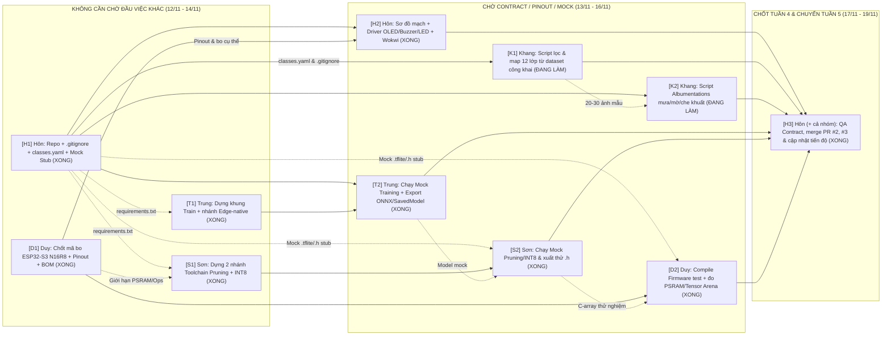
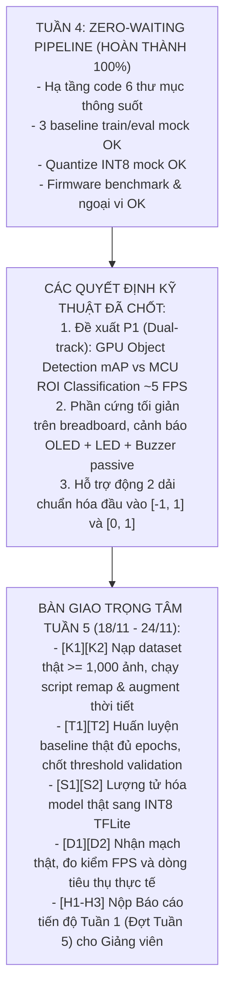

# KẾ HOẠCH THỰC HIỆN ĐỒ ÁN TUẦN 4 (11/11 – 17/11/2026)
## MÔN: TRÍ TUỆ NHÂN TẠO CHO HỆ THỐNG NHÚNG (`CE340`) — ĐỀ TÀI EDGE AI & TINYML

> **Khoảng thời gian:** Thứ Tư `11/11/2026` – Thứ Ba `17/11/2026` *(Tuần 4 — Khởi động Zero-Waiting Pipeline; khung thực thi tập trung `12/11 – 17/11/2026`)*  
> **Trạng thái tài liệu:** 🟢 **ĐÃ NGHIỆM THU (19/11/2026)** — Toàn bộ sản phẩm Tuần 4 đã được tích hợp sạch vào nhánh `main` (Commits: `e56c65a`, `0dc8d64`, `fa06698`, `ee20191`, `aa1679e`).  
> **Tài liệu tham chiếu:** [De_Cuong_Chi_Tiet_Do_An_CE340.md](./De_Cuong_Chi_Tiet_Do_An_CE340.md) | [Khao_Sat_De_Tai_Va_Phuong_An_Thiet_Ke_CE340.md](./Khao_Sat_De_Tai_Va_Phuong_An_Thiet_Ke_CE340.md) | [Ke_Hoach_Thuc_Hien_Do_An_CE340_Nhom_Hon.xlsx](./Ke_Hoach_Thuc_Hien_Do_An_CE340_Nhom_Hon.xlsx) | [README.md](./README.md)  
> **Phạm vi tài liệu:** Liệt kê các đầu việc **thuộc Đồ án CE340** của 5 thành viên trong Tuần 4 theo bảng phân công đã cập nhật (hoán đổi nhiệm vụ giữa **Vũ Văn Duy** – Nhúng & Thực nghiệm và **Hoàng Cao Sơn** – Tối ưu hóa TinyML). Mỗi đầu việc ghi rõ **Đầu vào (Inputs)**, trạng thái **Chờ người khác hoàn thành**, **Sản phẩm bàn giao thực tế** và **kết quả nghiệm thu**.  
> **Quy ước GitHub & Contract-First:** GitHub chỉ lưu mã nguồn, `classes.yaml`, `requirements.txt`, tài liệu, ảnh preview mẫu nhỏ và file `.tflite`/`.h` gọn; **toàn bộ dataset ảnh (`images/`, `raw/`) và trọng số lớn (`.pt`, `.onnx`) được chặn bởi `.gitignore` và lưu trên Google Drive / Roboflow**.

---

## I. SƠ ĐỒ PHỤ THUỘC ĐẦU VIỆC (AI LÀM LUÔN – AI CHỜ AI?)

---

## II. MA TRẬN PHỤ THUỘC TỔNG HỢP GIỮA 5 THÀNH VIÊN

| Thành viên | MSSV | Đầu việc làm được NGAY (Không chờ ai) | Đầu việc PHẢI CHỜ người khác | Vai trò mở khóa cho người sau | Trạng thái Tuần 4 |
| :--- | :---: | :--- | :--- | :--- | :---: |
| **Trần Hoàng Hôn** *(Trưởng nhóm / PM, QA & Ngoại vi)* | `26410046` | `[H1]` | • `[H2]` (cần `[H1]` + pinout từ `[D1]`) • `[H3]` (chờ nghiệm thu toàn nhóm `17/11–19/11`) | **`[H1]` mở khóa Zero-Waiting cho cả nhóm** — cung cấp `.gitignore`, `classes.yaml` và *Mock Stub*. `[H3]` nghiệm thu merge PRs. | 🟢 **100% Hoàn thành** |
| **Nguyễn Duy Khang** *(Kỹ sư Dữ liệu & Tăng cường ảnh)* | `26410055` | *(Tải trước dataset Zalo AI / Roboflow về Drive)* | • `[K1]` (chờ `classes.yaml` từ `[H1]` để chốt `class_id` `0..11`) • `[K2]` (chờ `[H1]` + subset ảnh mẫu từ `[K1]`) | **`[K1]` & `[K2]` mở khóa** nguồn dữ liệu thật và dữ liệu thời tiết khắc nghiệt cho Tuần 5 của Trung và hiệu chuẩn của Sơn. | 🟡 **Đang triển khai** (Chuyển tiếp Tuần 5) |
| **Phạm Thành Trung** *(Kỹ sư AI — Huấn luyện & Benchmark)* | `26410141` | `[T1]` *(khớp phiên bản thư viện với `[H1]`/`[S1]`)* | • `[T2]` (chờ `[T1]` của Trung + bộ ảnh mock từ `[H1]`) | **`[T2]` mở khóa** 2 định dạng model trung gian (`SavedModel`/`Keras` cho nhánh TF & `ONNX` cho nhánh PyTorch) cho `[S2]`. | 🟢 **100% Hoàn thành** |
| **Hoàng Cao Sơn** *(Kỹ sư Tối ưu hóa TinyML)* | `25730061` | `[S1]` *(khớp giới hạn bộ nhớ với `[D1]`)* | • `[S2]` (chờ `[S1]` của Sơn + model mock từ `[H1]`/`[T2]`, kèm giới hạn bộ nhớ từ `[D1]`) | **`[S2]` mở khóa** file `.tflite` INT8 và mảng C-array `.h` chuẩn toán tử `tflite-micro` để Duy kiểm tra nạp `ESP32-S3`. | 🟢 **100% Hoàn thành** |
| **Vũ Văn Duy** *(Kỹ sư Nhúng & Thực nghiệm)* | `26410031` | `[D1]` | • `[D2]` (chờ `[D1]` của Duy + file `.tflite`/`.h` stub từ `[H1]`/`[S2]`) | **`[D1]` mở khóa** mã bo chính xác + sơ đồ chân (*Pinout*, né `GPIO 33–37` PSRAM) cho `[H2]` của Hôn và giới hạn bộ nhớ cho `[S1]`/`[S2]` của Sơn. | 🟢 **100% Hoàn thành** |

---

## III. KẾ HOẠCH CHI TIẾT & TIẾN ĐỘ THỰC TẾ TỪNG THÀNH VIÊN

### 1. Trần Hoàng Hôn (`26410046`) — Trưởng nhóm / PM, QA & Giao tiếp ngoại vi
*Định mức CE340 Tuần 4: ~3.0 giờ (khởi tạo khung Zero-Waiting, bảo vệ Repo Hygiene, chuẩn hóa ngoại vi & điều phối sync)*

| Mã CV & Hạn | Đầu việc Đồ án | Trạng thái thực tế | Sản phẩm bàn giao nghiệm thu (Deliverables) |
| :--- | :--- | :---: | :--- |
| **`[H1]`** 12/11 – 13/11 | Khởi tạo cấu trúc Repo, cập nhật `.gitignore`, chốt `classes.yaml` (12 lớp) & tạo *Mock Stub* | 🟢 **Hoàn thành 100%** *(Commit `e56c65a`)* | • 6 thư mục cấu trúc chuẩn: `01_dataset/`, `02_augmentation/`, `03_models_benchmark/`, `04_tinyml_optimization/`, `05_firmware_esp32s3/`, `06_reports_slides/` • File [`01_dataset/classes.yaml`](./01_dataset/classes.yaml) (khóa 12 lớp QCVN 41:2019) • File [`.gitignore`](./.gitignore) chặn dataset nặng & weights • Bộ stub `01_dataset/mock_assets/` (5 ảnh, nhãn YOLO, model mock). |
| **`[H2]`** 13/11 – 15/11 | Thiết kế sơ đồ đấu nối phần cứng & viết module driver test ngoại vi ghi-đông (`OLED`, `Buzzer`, `LED`) | 🟢 **Hoàn thành 100%** *(Commit `aa1679e`)* | • Sơ đồ đấu nối trực quan: [`05_firmware_esp32s3/images/wiring_diagram.svg`](./05_firmware_esp32s3/images/wiring_diagram.svg) (phối hợp cùng Duy) • Project kiểm thử ngoại vi hoàn chỉnh: [`05_firmware_esp32s3/peripherals_test/`](./05_firmware_esp32s3/peripherals_test/) gồm driver màn hình `SH1106 1.3" I2C` (SDA 41, SCL 42), driver còi `Buzzer PWM LEDC` (GPIO 14), driver `LED đỏ` (GPIO 21), nút Mute (GPIO 47), kèm mô phỏng trực quan trên trình duyệt qua `Wokwi` (`diagram.json`). |
| **`[H3]`** 16/11 – 17/11 | Điều phối họp sync cuối Tuần 4, kiểm tra chéo (QA), review PR & cập nhật tiến độ | 🟢 **Hoàn thành 100%** *(19/11/2026)* | • Tổ chức rà soát kỹ thuật liên phân hệ, phát hiện và fix lỗi không tương thích mảng C-array giữa Sơn và Duy • Bổ sung dải chuẩn hóa động (`[-1, 1]` & `[0, 1]`) vào firmware • Review và merge thành công **PR #2** (Duy) và **PR #3** (Sơn) vào nhánh `main` • Tài liệu phân tích tình huống xe máy: [`06_reports_slides/tinh_huong_thuc_te_va_tieu_chi_danh_gia.md`](./06_reports_slides/tinh_huong_thuc_te_va_tieu_chi_danh_gia.md). |

---

### 2. Nguyễn Duy Khang (`26410055`) — Kỹ sư Dữ liệu & Tăng cường ảnh
*Định mức CE340 Tuần 4: ~3.0 giờ | Thu thập & tiền xử lý dữ liệu từ các tập công khai (Zalo AI, VNTS, Roboflow)*

| Mã CV & Hạn | Đầu việc Đồ án | Trạng thái thực tế | Sản phẩm bàn giao nghiệm thu (Deliverables) |
| :--- | :--- | :---: | :--- |
| **`[K1]`** 12/11 – 15/11 | Thu thập & chạy script chuẩn hóa nhãn 12 lớp biển báo Việt Nam từ dữ liệu công khai | 🟡 **Đang triển khai** *(Chuyển tiếp Tuần 5)* | • Đã rà soát nguồn dữ liệu (Zalo AI, Roboflow Universe) và lưu trữ trên Google Drive • Đã đối chiếu mã QCVN 41:2019 chuẩn theo `classes.yaml` (`P.123a/b`, `P.104`) • Kế hoạch Tuần 5: Hoàn thiện script `01_dataset/remap_and_split.py` và báo cáo phân bố nhãn `01_dataset/dataset_summary.md` trên tập dữ liệu thật $\ge 1,000$ ảnh. |
| **`[K2]`** 13/11 – 16/11 | Xây dựng & kiểm thử script `Albumentations` tăng cường dữ liệu thời tiết phức tạp | 🟡 **Đang triển khai** *(Chuyển tiếp Tuần 5)* | • Đã chốt 4 kịch bản thời tiết: mưa đọng ống kính (`RandomRain`), mờ rung lắc (`MotionBlur`), che khuất (`CoarseDropout`), thiếu sáng ban đêm (`RandomBrightnessContrast`) • Kế hoạch Tuần 5: Đóng gói script `02_augmentation/augment_weather.py` và xuất 20 ảnh mẫu kiểm chứng `02_augmentation/preview_samples/`. |

---

### 3. Phạm Thành Trung (`26410141`) — Kỹ sư AI (Huấn luyện & Benchmark)
*Định mức CE340 Tuần 4: ~2.5 giờ | Dựng khung train 3 mô hình benchmark + nhánh Edge-native tương thích phần cứng thật*

| Mã CV & Hạn | Đầu việc Đồ án | Trạng thái thực tế | Sản phẩm bàn giao nghiệm thu (Deliverables) |
| :--- | :--- | :---: | :--- |
| **`[T1]`** 12/11 – 14/11 | Thiết lập môi trường GPU & dựng khung huấn luyện 3 kiến trúc (`YOLOv8n`, `YOLOv5-tiny`, `MobileNetV2-SSD`) + cấu hình input cho Edge | 🟢 **Hoàn thành 100%** *(Commit `0dc8d64`)* | • Mã nguồn khung huấn luyện: [`03_models_benchmark/train_baseline.py`](./03_models_benchmark/train_baseline.py) hỗ trợ cả 3 kiến trúc • Module SSD nhiều tầng: [`03_models_benchmark/mobilenetv2_ssd.py`](./03_models_benchmark/mobilenetv2_ssd.py) (tự sinh anchors, đọc nhãn YOLO, lưu cả `.keras` lẫn SavedModel với `TF_USE_LEGACY_KERAS=1`) • Hỗ trợ tham số `--imgsz` linh hoạt (`160`, `192`, `320`). |
| **`[T2]`** 14/11 – 16/11 | Chạy thử **Mock Training Pipeline**, chuẩn hóa hàm Benchmark & kiểm tra Export cho 2 luồng TinyML | 🟢 **Hoàn thành 100%** *(Commit `0dc8d64`)* | • Script đánh giá độc lập: [`03_models_benchmark/evaluate_benchmark.py`](./03_models_benchmark/evaluate_benchmark.py) (đo macro P/R/F1, mAP@0.5, mAP@0.5:0.95 và ma trận nhầm lẫn) • Xuất sạch 2 định dạng trung gian: ONNX cho YOLOv8n (`12.63 MB`), YOLOv5u (`10.62 MB`) và SavedModel/Keras cho MobileNetV2-SSD • Báo cáo kết quả smoke AI: [`06_reports_slides/week4_ai_smoke_report.md`](./06_reports_slides/week4_ai_smoke_report.md). |

---

### 4. Hoàng Cao Sơn (`25730061`) — Kỹ sư Tối ưu hóa (TinyML)
*Định mức CE340 Tuần 4: ~2.5–3.0 giờ | Tách đúng 2 toolchain Pruning + Full INT8 tương thích `ESP32-S3`*

| Mã CV & Hạn | Đầu việc Đồ án | Trạng thái thực tế | Sản phẩm bàn giao nghiệm thu (Deliverables) |
| :--- | :--- | :---: | :--- |
| **`[S1]`** 12/11 – 14/11 | Nghiên cứu & thiết lập **2 luồng toolchain** nén TinyML (`Pruning` + `INT8`) tương thích `tflite-micro` trên `ESP32-S3` | 🟢 **Hoàn thành 100%** *(PR #3 commit `84e85b3`)* | • Tài liệu kỹ thuật: [`04_tinyml_optimization/tinyml_toolchain_notes.md`](./04_tinyml_optimization/tinyml_toolchain_notes.md) • Chốt ngân sách bộ nhớ `ESP32-S3 N16R8` (`Flash 16MB`, `PSRAM 8MB`, arena 1–4MB) • Phân định rõ 2 luồng: Keras (`tfmot` + Full INT8 scale `[-1, 1]`) và PyTorch (Structured Pruning + `onnx2tf` scale `[0, 1]`) • Bảng kiểm toán tử `tflite-micro` / `ESP-NN` và lưu ý decode box ngoài graph C++. |
| **`[S2]`** 14/11 – 16/11 | Dựng **Mock Optimization Pipeline**: chạy thử `Pruning` + `Full Integer INT8` & xuất C-array `.h` | 🟢 **Hoàn thành 100%** *(PR #3 commit `0605b88` / `ee20191`)* | • Script nén hoàn chỉnh: [`04_tinyml_optimization/quantize_int8_mock.py`](./04_tinyml_optimization/quantize_int8_mock.py) • Áp dụng `tfmot` pruning + Full Integer Quantization (`int8` I/O) với `representative_dataset`, kiểm chứng nén đạt **> 70%** so với FP32 • Xuất mảng C-array: [`04_tinyml_optimization/mock_model_int8.h`](./04_tinyml_optimization/mock_model_int8.h) (`alignas(16)`, 5,944 bytes, kèm alias `g_mock_model_int8` tương thích với firmware). |

---

### 5. Vũ Văn Duy (`26410031`) — Kỹ sư Nhúng & Thực nghiệm
*Định mức CE340 Tuần 4: ~2.5–3.0 giờ | Chốt mã bo `ESP32-S3-CAM` & dựng firmware đo đạc thực nghiệm*

| Mã CV & Hạn | Đầu việc Đồ án | Trạng thái thực tế | Sản phẩm bàn giao nghiệm thu (Deliverables) |
| :--- | :--- | :---: | :--- |
| **`[D1]`** 12/11 – 13/11 | Khảo sát, chốt **đúng mã bo** `ESP32-S3-CAM N16R8`, lập BOM linh kiện, lên phương án hộp ghi-đông & đặt hàng | 🟢 **Hoàn thành 100%** *(PR #2 commit `845f0fc`)* | • Báo cáo chi tiết: [`05_firmware_esp32s3/bom_and_hardware_specs.md`](./05_firmware_esp32s3/bom_and_hardware_specs.md) • Chốt bo `ESP32-S3-CAM N16R8` (Freenove pinout, camera OV2640 góc 66°) • Bảng chân chi tiết, né toàn bộ dải `GPIO 33–37` của Octal PSRAM • BOM tinh gọn breadboard (~0.8–1.3 triệu VND, bỏ motor rung và vỏ chống nước để tập trung AI) • 4 bản vẽ SVG: sơ đồ nối dây, hướng dẫn chọn bo, minh họa linh kiện B/C. |
| **`[D2]`** 14/11 – 16/11 | Cài đặt IDE nhúng & dựng **Mock Firmware** kiểm tra biên dịch + đo `Tensor Arena` | 🟢 **Hoàn thành VƯỢT MỨC 100%** *(PR #2 commit `fa06698`)* | • Project firmware chuẩn: [`05_firmware_esp32s3/mock_inference_test/`](./05_firmware_esp32s3/mock_inference_test/) • Đo đạc chuyên sâu: So sánh `Invoke()` và arena giữa **Internal SRAM** vs **Octal PSRAM** • Đo tốc độ chụp ảnh OV2640 (QVGA, VGA RGB565) • Pipeline đầu-cuối A/B/C/C2 (crop ROI góc trên-phải $\rightarrow$ zero-copy LUT quantize $\rightarrow$ Invoke $\rightarrow$ argmax) • Hỗ trợ động 2 dải chuẩn hóa `InputNorm`: `NORM_0_TO_1` và `NORM_MINUS1_TO_1` • Soak test công suất / nhiệt độ và ghi log CSV ra thẻ nhớ microSD (`/sdcard/bench.csv`). |

---

## IV. CHECKLIST NGHIỆM THU TUẦN 4 (`DEFINITION OF DONE` — ĐÃ HOÀN THÀNH)

- [x] **Repo Hygiene & Data Contract (`[H1]`, `[H2]`):** Đủ 6 thư mục trên GitHub; `.gitignore` đã chặn dataset ảnh & file trọng số lớn; `01_dataset/classes.yaml` khóa đúng `12` lớp kèm ánh xạ mã QCVN 41:2019 chính xác; có sơ đồ nối dây SVG và module test ngoại vi [`05_firmware_esp32s3/peripherals_test/`](./05_firmware_esp32s3/peripherals_test/) (OLED SH1106, Buzzer PWM, LED, nút bấm) kèm mô phỏng Wokwi.
- [ ] **Dataset & Weather Augmentation (`[K1]`, `[K2]`):** *Chuyển tiếp sang Tuần 5.* Đã thu thập dataset thô trên Drive; cần xuất script `remap_and_split.py` (tập 12 lớp chia 70/20/10) và script `augment_weather.py` (4 kịch bản thời tiết kèm 20 ảnh mẫu kiểm chứng).
- [x] **Mock Training & Edge Feasibility (`[T1]`, `[T2]`):** Khung code chạy smoke-test thành công (`train_baseline.py`, `mobilenetv2_ssd.py`), xuất được chỉ số (`Precision`, `Recall`, `F1-Score`, `mAP@0.5`, ma trận nhầm lẫn) và export sạch cả 2 định dạng (`SavedModel/Keras` cho nhánh TF & `ONNX` cho nhánh PyTorch), hỗ trợ cấu hình `--imgsz 160/192/320`.
- [x] **Mock TinyML Optimization (`[S1]`, `[S2]`):** Đã tách rõ 2 luồng Pruning (`tfmot` cho TF vs `torch.nn.utils.prune` cho PyTorch), chạy thông `Full Integer INT8` giảm dung lượng $\ge 70\%$ và xuất được `mock_model_int8.h` (`alignas(16)`) hợp lệ với ops của `tflite-micro`, bổ sung alias tương thích cho firmware.
- [x] **BOM Phần cứng & Mock Firmware (`[D1]`, `[D2]`):** Chốt đúng mã bo `ESP32-S3-CAM N16R8` (8MB Octal PSRAM), Pinout né `GPIO 33–37`, BOM tinh gọn & hướng dẫn mua; firmware mock biên dịch sạch, đo đạc so sánh arena SRAM vs PSRAM, pipeline ROI A/B/C/C2, soak test nhiệt độ/mA và ghi thẻ microSD.
- [x] **Đồng bộ cuối tuần (`[H3]`):** Tổ chức nghiệm thu kỹ thuật, fix lỗi tương thích liên phân hệ, merge thành công **PR #2** và **PR #3** vào nhánh `main` GitHub, hoàn thiện tài liệu tình huống thực tế và cập nhật tiến độ đồ án.

---

## V. TỔNG KẾT NGHIỆM THU TUẦN 4 & BÀN GIAO SANG TUẦN 5

### Các quyết định kỹ thuật cốt lõi đã chốt ở buổi sync:
1. **Kiến trúc hai luồng (Dual-track — Đề xuất P1):**
   * **Mốc so sánh GPU (Đề cương khoa học):** Duy trì bài toán **Object Detection** (`YOLOv8n`, `YOLOv5u nano`, `MobileNetV2-SSD`), đo lường độ chính xác `mAP@0.5` và `mAP@0.5:0.95`.
   * **Mô hình chạy trên chip ESP32-S3:** Chạy mô hình **Phân loại trên vùng ROI** (cắt góc trên-phải hoặc lọc màu/hình học), giải mã trực tiếp bằng `argmax`, bảo đảm tốc độ thực tế $\approx 5\text{ FPS}$ mà không bị nghẽn bởi toán tử NMS/DFL.
2. **Phương án phần cứng tinh gọn (Đề xuất D1):**
   * Không làm hộp đúc kín nước và bỏ motor rung ở tay lái để giảm rủi ro cơ khí. Triển khai demo cắm mạch trên breadboard, cảnh báo chính qua màn hình OLED 1.3" và LED đỏ siêu sáng, còi Buzzer passive cảnh báo âm thanh. Demo chính bằng cách phát lại video đường phố trước camera trên bàn test.
3. **Đồng bộ hóa giao tiếp dữ liệu:**
   * Chuẩn hóa Data Contract 12 lớp QCVN 41:2019.
   * Firmware hỗ trợ linh hoạt cả dải chuẩn hóa `[-1, 1]` (MobileNetV2-SSD) và `[0, 1]` (YOLO).
   * Mảng C-array header hỗ trợ đầy đủ alias `g_mock_model_int8` và `g_tinyml_mock_model_int8`.
