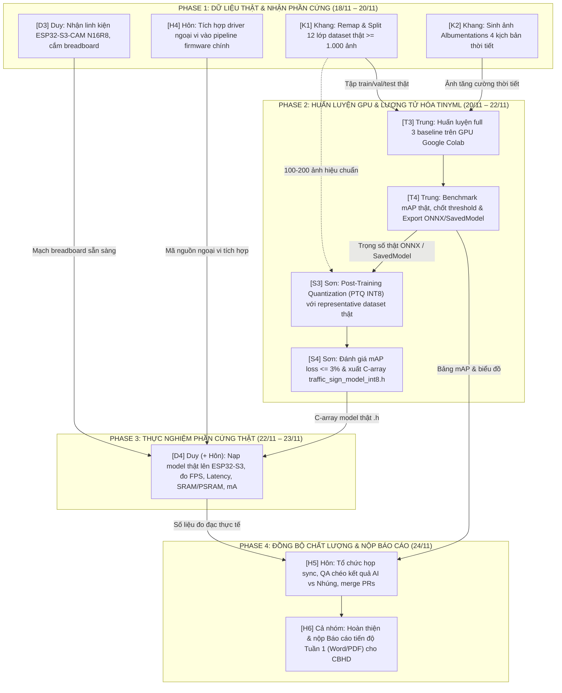
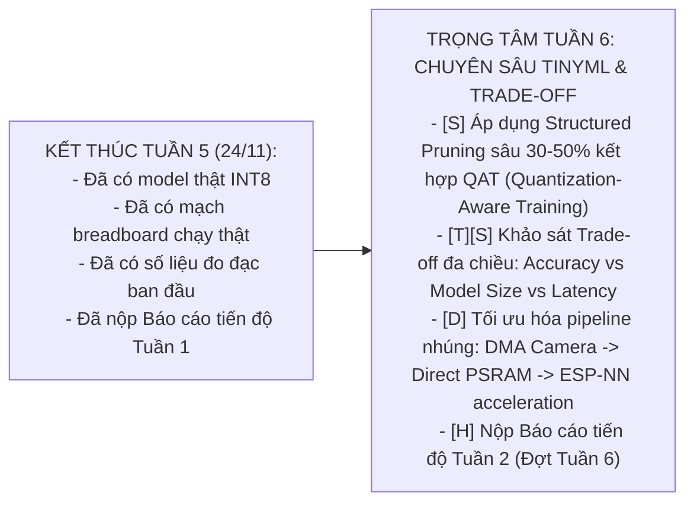

# KẾ HOẠCH THỰC HIỆN ĐỒ ÁN TUẦN 5 (18/11 – 24/11/2026)
## MÔN: TRÍ TUỆ NHÂN TẠO CHO HỆ THỐNG NHÚNG (`CE340`) — ĐỀ TÀI EDGE AI & TINYML

> **Khoảng thời gian:** Thứ Tư `18/11/2026` – Thứ Ba `24/11/2026` *(Tuần 5 — Chuyển dịch toàn diện từ Mock Stub sang **Dữ liệu thật & Phần cứng thật**)*  
> **Trạng thái tài liệu:** 🟡 **ĐANG THỰC HIỆN (Active Execution)** — Khởi động ngày 18/11/2026, nghiệm thu và nộp Báo cáo tiến độ Tuần 1 vào ngày 24/11/2026.  
> **Tài liệu tham chiếu:** [De_Cuong_Chi_Tiet_Do_An_CE340.md](./De_Cuong_Chi_Tiet_Do_An_CE340.md) | [Ke_Hoach_Thuc_Hien_Tuan_4.md](./Ke_Hoach_Thuc_Hien_Tuan_4.md) | [classes.yaml](./01_dataset/classes.yaml) | [tinyml_toolchain_notes.md](./04_tinyml_optimization/tinyml_toolchain_notes.md) | [bom_and_hardware_specs.md](./05_firmware_esp32s3/bom_and_hardware_specs.md)  
> **Mục tiêu tối thượng Tuần 5:**
> 1. Hoàn thành bộ dữ liệu thật $\ge 1.000$ ảnh gán nhãn 12 lớp QCVN 41:2019 kèm tập tăng cường thời tiết phức tạp.
> 2. Huấn luyện chính thức (full epochs) 3 mô hình baseline (`YOLOv8n`, `YOLOv5u nano`, `MobileNetV2-SSD`), chốt mAP benchmark thật.
> 3. Lượng tử hóa mô hình thật sang INT8 (`.tflite` & C-array header `traffic_sign_model_int8.h`).
> 4. Tiếp nhận bo mạch thật `ESP32-S3-CAM N16R8`, cắm breadboard hoàn chỉnh, nạp firmware đo đạc thực tế (FPS, Latency, mA).
> 5. Hoàn thiện và nộp **Báo cáo tiến độ Tuần 1 (Đợt Tuần 5)** gửi Cán bộ hướng dẫn (ThS. Phan Đình Duy).

---

## I. SƠ ĐỒ PHỤ THUỘC ĐẦU VIỆC TUẦN 5 (WORKFLOW PIPELINE)



---

## II. MA TRẬN PHỤ THUỘC TỔNG HỢP GIỮA 5 THÀNH VIÊN (TUẦN 5)

| Thành viên | MSSV | Đầu việc làm được NGAY (18/11 – 20/11) | Đầu việc PHẢI CHỜ người khác | Vai trò mở khóa cho người sau | Trọng tâm bàn giao Tuần 5 |
| :--- | :---: | :--- | :--- | :--- | :---: |
| **Trần Hoàng Hôn** *(Trưởng nhóm / PM, QA & Ngoại vi)* | `26410046` | **`[H4]`**: Ghép nối mã nguồn driver ngoại vi (`peripherals_test`) vào khung firmware suy luận chính. | • **`[H5]`**: Chờ số liệu đo đạc từ `[D4]` và benchmark từ `[T4]`.<br>• **`[H6]`**: Chờ xác nhận hoàn thành từ 4 thành viên. | **`[H4]` mở khóa** khung code tích hợp cho Duy; **`[H5]–[H6]` điều phối** nghiệm thu và nộp báo cáo đúng hạn. | 🟢 **Bàn giao khung tích hợp & Báo cáo tiến độ Tuần 1** |
| **Nguyễn Duy Khang** *(Kỹ sư Dữ liệu & Tăng cường ảnh)* | `26410055` | **`[K1]`**: Chạy `remap_and_split.py` trên dataset công khai.<br>**`[K2]`**: Chạy `augment_weather.py` sinh ảnh thời tiết. | Không bị phụ thuộc (đã có `classes.yaml` từ Tuần 4 và dữ liệu thô trên Drive). | **`[K1]` & `[K2]` mở khóa** dữ liệu thật để Trung huấn luyện và tập ảnh hiệu chuẩn cho Sơn lượng tử hóa. | 🟢 **Dataset $\ge 1.000$ ảnh & 20 ảnh mẫu augment** |
| **Phạm Thành Trung** *(Kỹ sư AI — Huấn luyện & Benchmark)* | `26410141` | Chuẩn bị sẵn Colab Notebook, script huấn luyện và mount Google Drive. | **`[T3]` & `[T4]`**: Chờ bộ dữ liệu đã remap/split từ `[K1]` và dữ liệu tăng cường từ `[K2]`. | **`[T4]` mở khóa** file trọng số mô hình thật (`best.pt`, `SavedModel`, `ONNX`) cho Sơn tối ưu hóa. | 🟢 **3 model baseline trained & bảng mAP thật** |
| **Hoàng Cao Sơn** *(Kỹ sư Tối ưu hóa TinyML)* | `25730061` | Chuẩn bị sẵn script PTQ INT8 và môi trường `tensorflow`, `tfmot`, `onnx2tf`. | **`[S3]` & `[S4]`**: Chờ trọng số mô hình thật từ `[T4]` và tập ảnh hiệu chuẩn từ `[K1]`. | **`[S4]` mở khóa** file `.tflite` INT8 và mảng C-array header `traffic_sign_model_int8.h` cho Duy nạp kit. | 🟢 **Model INT8 nén $>70\%$ & C-array header thật** |
| **Vũ Văn Duy** *(Kỹ sư Nhúng & Thực nghiệm)* | `26410031` | **`[D3]`**: Tiếp nhận kit `ESP32-S3-CAM N16R8`, cắm mạch breadboard, kiểm tra camera OV2640 & OLED. | **`[D4]`**: Chờ mảng C-array thật từ `[S4]` và khung code tích hợp từ `[H4]`. | **`[D4]` chốt hạ** toàn bộ số liệu thực nghiệm phần cứng thật để nhóm đưa vào Báo cáo tiến độ Tuần 1. | 🟢 **Mạch thật hoạt động & Bảng đo đạc FPS/Latency/mA** |

---

## III. KẾ HOẠCH CHI TIẾT TỪNG THÀNH VIÊN (WBS & DELIVERABLES)

### 1. Trần Hoàng Hôn (`26410046`) — Trưởng nhóm / PM, QA & Giao tiếp ngoại vi
*Định mức CE340 Tuần 5: ~3.5 giờ | Điều phối tích hợp toàn hệ thống, kiểm soát chất lượng bàn giao & nộp báo cáo*

| Mã CV & Hạn | Đầu việc Đồ án | Đầu vào (Inputs) & Điều kiện chờ | Sản phẩm bàn giao cụ thể (Deliverables) | Tiêu chí nghiệm thu (Acceptance Criteria) |
| :--- | :--- | :--- | :--- | :--- |
| **`[H4]`**<br>18/11 – 20/11 | Tích hợp module ngoại vi ghi-đông (`peripherals_test`) vào dự án firmware chính | Mã nguồn `peripherals_test/` (Tuần 4) + `mock_inference_test/` | • File mã nguồn tích hợp `05_firmware_esp32s3/main/app_main.cpp`<br>• Khung quản lý tác vụ FreeRTOS (Task Camera & Inference riêng, Task HMI OLED/Buzzer riêng). | • Biên dịch sạch không lỗi trên PlatformIO.<br>• Khi phát hiện nhãn mô phỏng, OLED cập nhật thông tin và còi Buzzer PWM kêu đúng nhịp.<br>• Nút Mute ngắt còi thành công qua cơ chế ngắt/event. |
| **`[H5]`**<br>22/11 – 23/11 | Điều phối kiểm thử tích hợp phần cứng, QA chéo số liệu AI vs Nhúng & Review PRs | Sản phẩm từ `[D4]`, `[T4]`, `[S4]` | • Biên bản họp sync Tuần 5 `06_reports_slides/week5_sync_notes.md`<br>• Nhánh `main` GitHub được merge sạch các PR của tuần<br>• Giải quyết triệt để các xung đột (conflict/mismatch). | • Đảm bảo 100% code trên GitHub chạy được, không lỗi build.<br>• Toàn bộ số liệu mAP, FPS, Latency được đối soát chéo khớp nhau giữa các báo cáo. |
| **`[H6]`**<br>23/11 – 24/11 | Hoàn thiện và nộp **Báo cáo tiến độ Tuần 1 (Đợt Tuần 5)** gửi Giảng viên hướng dẫn | Toàn bộ số liệu và kết quả Tuần 4 + Tuần 5 của 5 thành viên | • File Báo cáo tiến độ Word & PDF: `06_reports_slides/Bao_Cao_Tuan_5_CE340.docx`<br>• Email / Nộp bài hệ thống đúng hạn trước 23h59 ngày 24/11/2026. | • Đúng mẫu quy định của Khoa KTMT (`Mẫu Báo cáo tuần x.docx`).<br>• Đầy đủ 4 mục: Nội dung, Phân công, Báo cáo quá trình, Kế hoạch tuần tới.<br>• Bảng số liệu định lượng rõ ràng, minh chứng ảnh chụp mạch thật. |

---

### 2. Nguyễn Duy Khang (`26410055`) — Kỹ sư Dữ liệu & Tăng cường ảnh
*Định mức CE340 Tuần 5: ~3.5 giờ | Hoàn tất dataset thật $\ge 1.000$ ảnh & Pipeline tăng cường thời tiết*

| Mã CV & Hạn | Đầu việc Đồ án | Đầu vào (Inputs) & Điều kiện chờ | Sản phẩm bàn giao cụ thể (Deliverables) | Tiêu chí nghiệm thu (Acceptance Criteria) |
| :--- | :--- | :--- | :--- | :--- |
| **`[K1]`**<br>18/11 – 20/11 | Chạy script trích xuất, ánh xạ nhãn 12 lớp QCVN 41:2019 và chia tập dữ liệu | Dữ liệu thô trên Google Drive (Zalo AI, VNTS, Roboflow) + `classes.yaml` | • Script xử lý: `01_dataset/remap_and_split.py`<br>• File báo cáo phân bố nhãn: `01_dataset/dataset_summary.md`<br>• Cấu trúc thư mục YOLO chuẩn trên Drive: `train/` (70%), `val/` (20%), `test/` (10%). | • Tổng số ảnh hợp lệ $\ge 1.000$ ảnh.<br>• Đủ 12 lớp biển báo, không bị mất cân bằng quá mức (mỗi lớp tối thiểu 40 ảnh).<br>• File `data.yaml` chỉ đúng đường dẫn và class names. |
| **`[K2]`**<br>19/11 – 21/11 | Đóng gói script Albumentations tăng cường 4 kịch bản thời tiết và xuất ảnh kiểm chứng | Script `K1` + Thư viện `albumentations` | • Script tăng cường: `02_augmentation/augment_weather.py`<br>• 20 ảnh mẫu kiểm chứng tại `02_augmentation/preview_samples/` (kèm file chú giải trực quan)<br>• Cung cấp tập tăng cường đưa vào luồng train của Trung. | • Thể hiện rõ 4 hiệu ứng: Mưa rơi (`RandomRain`), Mờ chuyển động (`MotionBlur`), Che khuất (`CoarseDropout`), Thiếu sáng (`RandomBrightnessContrast`).<br>• Tọa độ Bounding Box sau khi augment không bị biến dạng hoặc tràn ra ngoài ảnh. |

---

### 3. Phạm Thành Trung (`26410141`) — Kỹ sư AI (Huấn luyện & Benchmark)
*Định mức CE340 Tuần 5: ~3.5 giờ | Huấn luyện chính thức 3 kiến trúc baseline & Benchmark so sánh mAP thật*

| Mã CV & Hạn | Đầu việc Đồ án | Đầu vào (Inputs) & Điều kiện chờ | Sản phẩm bàn giao cụ thể (Deliverables) | Tiêu chí nghiệm thu (Acceptance Criteria) |
| :--- | :--- | :--- | :--- | :--- |
| **`[T3]`**<br>20/11 – 22/11 | Huấn luyện full epochs cho 3 kiến trúc (`YOLOv8n`, `YOLOv5u nano`, `MobileNetV2-SSD`) | Bộ dữ liệu thật từ `[K1]` và dữ liệu tăng cường từ `[K2]` | • Checkpoint trọng số mô hình tốt nhất (`best.pt`, `mobilenetv2_ssd.keras`) trên Google Drive<br>• File log quá trình huấn luyện: `loss_curves.png`, `train_log.csv`. | • Huấn luyện đủ số epoch hội tụ (tối thiểu 50 epochs cho YOLO, 30 epochs cho MobileNet).<br>• Không bị hiện tượng nổ gradient hoặc Overfitting nghiêm trọng.<br>• Hỗ trợ cấu hình `--imgsz 160` và `--imgsz 192` cho Edge. |
| **`[T4]`**<br>21/11 – 22/11 | Benchmark so sánh hiệu năng, chốt Threshold tối ưu và xuất mô hình trung gian | Trọng số từ `[T3]` + Script `evaluate_benchmark.py` | • Bảng tổng hợp chỉ số: `03_models_benchmark/benchmark_real_summary.csv` (Precision, Recall, F1, mAP@0.5, mAP@0.5:0.95)<br>• Ma trận nhầm lẫn `confusion_matrix_real.png`<br>• File mô hình export: `yolov8n.onnx`, `yolov5u.onnx`, `mobilenetv2_savedmodel/`. | • Đạt mAP@0.5 baseline $\ge 75\%$ trên tập validation tiêu chuẩn.<br>• Xác định ngưỡng Confidence Threshold cân bằng giữa Precision và Recall.<br>• Xuất mô hình ONNX / SavedModel sạch, sẵn sàng nạp cho toolchain TinyML của Sơn. |

---

### 4. Hoàng Cao Sơn (`25730061`) — Kỹ sư Tối ưu hóa (TinyML)
*Định mức CE340 Tuần 5: ~3.5 giờ | Lượng tử hóa Post-Training INT8 mô hình thật & Xuất C-array header*

| Mã CV & Hạn | Đầu việc Đồ án | Đầu vào (Inputs) & Điều kiện chờ | Sản phẩm bàn giao cụ thể (Deliverables) | Tiêu chí nghiệm thu (Acceptance Criteria) |
| :--- | :--- | :--- | :--- | :--- |
| **`[S3]`**<br>21/11 – 23/11 | Thực hiện Post-Training Quantization (Full INT8) cho mô hình thật | File ONNX / SavedModel từ `[T4]` + 100-200 ảnh calibration từ `[K1]` | • Script lượng tử hóa chính thức: `04_tinyml_optimization/quantize_real_model.py`<br>• File mô hình TFLite INT8: `04_tinyml_optimization/traffic_sign_model_int8.tflite`<br>• Báo cáo so sánh dung lượng FP32 vs INT8. | • Áp dụng Full Integer Quantization (toàn bộ weights, activations, input, output đều là `int8`).<br>• Tỷ lệ nén dung lượng mô hình đạt $\ge 70\%$ so với bản gốc FP32.<br>• 100% toán tử nằm trong tập hỗ trợ của `tflite-micro` và `ESP-NN`. |
| **`[S4]`**<br>22/11 – 23/11 | Đánh giá độ suy giảm chính xác (Quantization Error) & Xuất mảng C-array header | File `.tflite` từ `[S3]` + Tập test từ `[K1]` | • Báo cáo đối chiếu: `04_tinyml_optimization/quantization_tradeoff_report.md`<br>• File header C-array nạp firmware: `04_tinyml_optimization/traffic_sign_model_int8.h` (`alignas(16)`). | • Độ suy giảm mAP sau khi lượng tử hóa INT8 so với FP32 phải $\le 3.0\%$.<br>• Header file định nghĩa mảng `const unsigned char` căn chỉnh 16 bytes, có hằng số `traffic_sign_model_int8_len`. |

---

### 5. Vũ Văn Duy (`26410031`) — Kỹ sư Nhúng & Thực nghiệm
*Định mức CE340 Tuần 5: ~4.0 giờ | Lắp ráp mạch thật trên breadboard, nạp model thật & đo đạc thông số thực tế*

| Mã CV & Hạn | Đầu việc Đồ án | Đầu vào (Inputs) & Điều kiện chờ | Sản phẩm bàn giao cụ thể (Deliverables) | Tiêu chí nghiệm thu (Acceptance Criteria) |
| :--- | :--- | :--- | :--- | :--- |
| **`[D3]`**<br>18/11 – 20/11 | Tiếp nhận bo `ESP32-S3-CAM N16R8`, cắm mạch breadboard hoàn chỉnh theo sơ đồ an toàn | Bo mạch thật, camera OV2640, OLED SH1106, Buzzer, LED, điện trở, dây cắm, nguồn 5V | • Mạch vật lý hoàn chỉnh trên breadboard.<br>• Chụp 3 ảnh minh chứng thực tế: Toàn cảnh mạch, Cận cảnh nối chân né GPIO 33-37, Cụm màn hình OLED & còi.<br>• Firmware smoke test kiểm tra camera và I2C. | • Bo mạch khởi động ổn định, nạp được code qua cổng Type-C.<br>• Camera OV2640 chụp ảnh bình thường (không sọc nhiễu, không treo bus).<br>• Quét I2C phát hiện đúng địa chỉ `0x3C` của OLED SH1106. |
| **`[D4]`**<br>22/11 – 23/11 | Nạp mô hình INT8 thật, chạy suy luận thời gian thực & đo đạc toàn diện các thông số | Mạch thật `[D3]` + C-array `[S4]` + Khung firmware tích hợp `[H4]` | • Dự án firmware hoàn chỉnh: `05_firmware_esp32s3/real_inference_deployment/`<br>• Bảng số liệu đo đạc thực tế: `05_firmware_esp32s3/benchmark_hardware_results.csv`<br>• Video clip ngắn (~1-2 phút) quay cảnh bo mạch nhận diện biển báo thật trên bàn test. | • Tốc độ suy luận đạt $\ge 5 - 10\text{ FPS}$ (Pipeline ROI).<br>• Tổng độ trễ từ lúc chụp đến hiển thị cảnh báo $< 150\text{ ms}$.<br>• Đo đạc chính xác: RAM chiếm dụng (SRAM vs PSRAM), Flash chiếm dụng, Dòng tiêu thụ (mA). |

---

## IV. LỊCH TRÌNH THỰC HIỆN CHI TIẾT TỪNG NGÀY TRONG TUẦN 5

```
┌────────────────────────────────────────────────────────────────────────────────────────────────────────────────────────┐
│ THỨ TƯ (18/11)  │ [K1] Bắt đầu script remap dataset | [D3] Nhận bo mạch ESP32-S3-CAM & test nạp code                 │
│ THỨ NĂM (19/11) │ [K1] Hoàn tất chia 70/20/10 | [K2] Viết script augment thời tiết | [D3] Cắm breadboard hoàn chỉnh    │
│ THỨ SÁU (20/11) │ [K1][K2] Bàn giao dataset thật lên Drive | [T3] Khởi động train 3 baseline GPU Colab | [H4] Ghép code│
│ THỨ BẢY (21/11) │ [T3] Hoàn tất train | [T4] Benchmark mAP thật, export ONNX | [S3] Lượng tử hóa PTQ INT8 model thật   │
│ CHỦ NHẬT (22/11)│ [S4] Xuất C-array .h | [D4] Nạp model thật lên ESP32-S3, chạy suy luận thực tế & đo latency/FPS/mA   │
│ THỨ HAI (23/11) │ [D4] Hoàn tất bảng số liệu đo đạc & quay clip | [H5] Họp sync kỹ thuật, review PRs, đối soát dữ liệu│
│ THỨ BA (24/11)  │ [H6] Hoàn thiện Báo cáo tiến độ Tuần 1 (Word/PDF), ký xác nhận & nộp cho ThS. Phan Đình Duy         │
└────────────────────────────────────────────────────────────────────────────────────────────────────────────────────────┘
```

---

## V. CHECKLIST ĐỊNH NGHĨA HOÀN THÀNH (`DEFINITION OF DONE` — DOD TUẦN 5)

Mỗi phân hệ chỉ được xem là hoàn thành khi thỏa mãn đầy đủ các tiêu chí cứng sau:

- [ ] **1. Dữ liệu thật (`[K1]`, `[K2]`):**
  - Dataset thật $\ge 1.000$ ảnh gán nhãn YOLO đúng chuẩn 12 lớp QCVN 41:2019.
  - Phân chia tỷ lệ chuẩn 70% Train, 20% Validation, 10% Test.
  - Script Albumentations sinh được ảnh 4 kịch bản thời tiết; xuất đủ 20 ảnh mẫu kiểm chứng vào `02_augmentation/preview_samples/`.
  - Có file tổng kết phân bố nhãn `01_dataset/dataset_summary.md`.

- [ ] **2. Huấn luyện & Benchmark AI (`[T3]`, `[T4]`):**
  - Huấn luyện hoàn tất 3 kiến trúc baseline: `YOLOv8n`, `YOLOv5u nano`, `MobileNetV2-SSD`.
  - Đạt chỉ số mAP@0.5 baseline $\ge 75\%$ trên tập validation tiêu chuẩn.
  - File `benchmark_real_summary.csv` và ảnh ma trận nhầm lẫn `confusion_matrix_real.png`.
  - Xuất sạch các mô hình trung gian định dạng ONNX và SavedModel/Keras.

- [ ] **3. Tối ưu hóa TinyML (`[S3]`, `[S4]`):**
  - Thực hiện thành công Full Integer Quantization INT8 (weights + activations + I/O).
  - Tỷ lệ giảm dung lượng so với FP32 đạt $\ge 70\%$.
  - Mức suy giảm mAP sau lượng tử hóa $\le 3.0\%$.
  - File header `04_tinyml_optimization/traffic_sign_model_int8.h` (`alignas(16)`) biên dịch tương thích 100% với firmware nhúng.

- [ ] **4. Phần cứng & Firmware thực nghiệm (`[D3]`, `[D4]`):**
  - Mạch thật cắm hoàn chỉnh trên breadboard: `ESP32-S3-CAM`, `SH1106 OLED`, `Buzzer PWM`, `LED`, `Button`.
  - Đi dây an toàn, né hoàn toàn dải bus PSRAM `GPIO 33–37`.
  - Nạp firmware chạy suy luận mô hình thật, hiển thị kết quả lên OLED và phát còi cảnh báo chính xác.
  - Đo đạc thực tế: FPS $\ge 5 - 10$, Latency tổng $< 150\text{ ms}$, RAM/PSRAM, Dòng điện tiêu thụ (mA).
  - Có video clip ngắn minh chứng hoạt động thực tế trên bàn test.

- [ ] **5. Quản trị & Báo cáo tiến độ (`[H4]`, `[H5]`, `[H6]`):**
  - Toàn bộ mã nguồn mới được đẩy lên GitHub qua Pull Request và merge sạch vào nhánh `main`.
  - Hoàn thành tài liệu Báo cáo tiến độ Tuần 1 (Word & PDF) đúng quy chuẩn Khoa KTMT.
  - Nộp báo cáo cho Giảng viên hướng dẫn đúng hạn (trước 23h59 ngày 24/11/2026).

---

## VI. KẾ HOẠCH BÀN GIAO SANG TUẦN 6 (25/11 – 01/12/2026)



### Phương án dự phòng kỹ thuật (Contingency Plan):
1. **Nếu GPU Google Colab bị ngắt kết nối / hết quota:**
   * *Giải pháp:* Trung và Hôn đã chuẩn bị sẵn 2 tài khoản Colab dự phòng; checkpoint được lưu liên tục từng 5 epochs lên Google Drive để resume ngay mà không mất công train lại từ đầu.
2. **Nếu mô hình YOLO INT8 gặp toán tử không tương thích với `tflite-micro`:**
   * *Giải pháp:* Nhóm sử dụng mô hình dự phòng **MobileNetV2-SSD** (đã được thiết kế từ Tuần 4 với 100% toán tử cơ bản tương thích nhân `ESP-NN`) và bài toán phân loại vùng ROI (P1) giải mã ngoài bằng C++.
3. **Nếu nguồn cổng USB máy tính không đủ dòng cho ESP32-S3-CAM khi bật Wi-Fi/Camera:**
   * *Giải pháp:* Sử dụng adapter nguồn 5V/2A rời cắm trực tiếp vào breadboard hoặc module hạ áp MB102 cấp nguồn riêng cho nhánh camera và còi buzzer.
