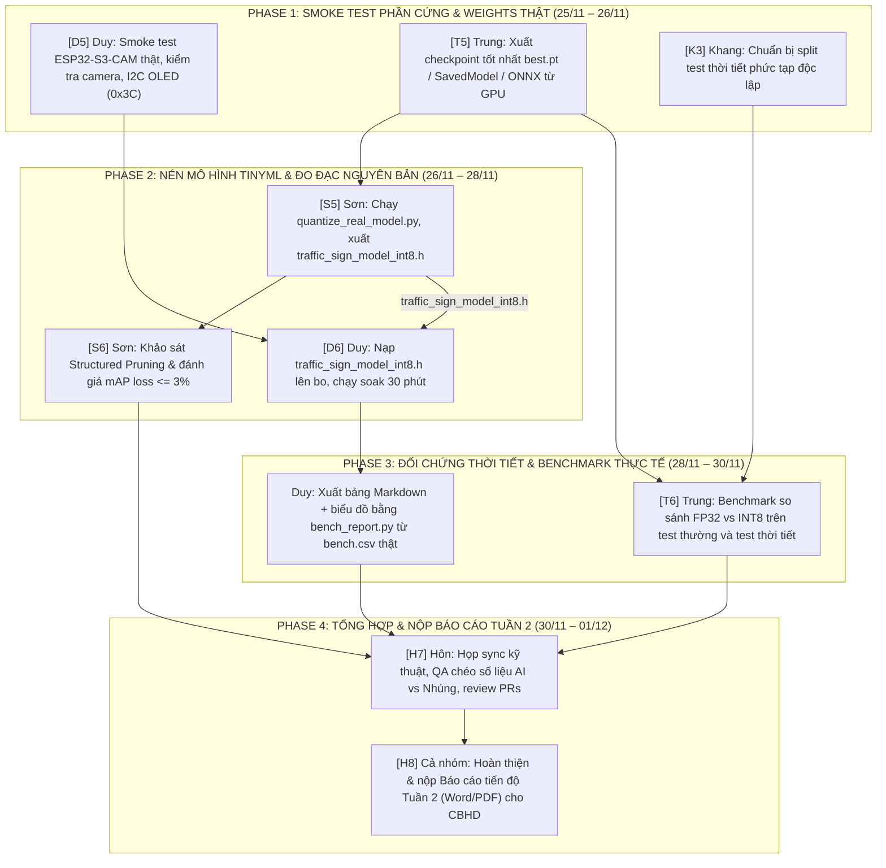

# KẾ HOẠCH THỰC HIỆN ĐỒ ÁN TUẦN 6 (25/11 – 01/12/2026)
## MÔN: TRÍ TUỆ NHÂN TẠO CHO HỆ THỐNG NHÚNG (`CE340`) — ĐỀ TÀI EDGE AI & TINYML

> **Khoảng thời gian:** Thứ Tư `25/11/2026` – Thứ Ba `01/12/2026` *(Tuần 6 — Tối ưu hóa TinyML chuyên sâu, Thực nghiệm Bo mạch thật & Hoàn thành Báo cáo tiến độ Tuần 2)*  
> **Trạng thái tài liệu:** 🟢 **KHỞI ĐỘNG CHÍNH THỨC TUẦN 6 (25/11/2026)** — Kế thừa trọn vẹn kết quả Tuần 5: Dữ liệu thật (PR #5), Script lượng tử hóa PTQ INT8 (PR #7) và Firmware cảnh báo demo + mô phỏng Wokwi (PR #8). Trọng tâm tuần này là đo đạc thực nghiệm trên kit ESP32-S3 thật, phân tích Trade-off đa chiều TinyML và hoàn thành Báo cáo tiến độ Tuần 2 nộp Giảng viên hướng dẫn.  
> **Tài liệu tham chiếu:** [De_Cuong_Chi_Tiet_Do_An_CE340.md](./De_Cuong_Chi_Tiet_Do_An_CE340.md) | [Ke_Hoach_Thuc_Hien_Tuan_5.md](./Ke_Hoach_Thuc_Hien_Tuan_5.md) | [classes.yaml](./01_dataset/classes.yaml) | [tinyml_toolchain_notes.md](./04_tinyml_optimization/tinyml_toolchain_notes.md) | [bom_and_hardware_specs.md](./05_firmware_esp32s3/bom_and_hardware_specs.md) | [giai_thich_phan_viec_duy.md](./05_firmware_esp32s3/giai_thich_phan_viec_duy.md)  
> **Mục tiêu tối thượng Tuần 6:**
> 1. **Thực nghiệm phần cứng thật:** Nạp firmware đo (`mock_inference_test`) và firmware demo (`traffic_sign_alert`) lên kit `ESP32-S3-CAM N16R8` thật; đo đạc số liệu thật 30 phút soak (FPS, Latency, SRAM/PSRAM, dòng mA). *(Duy + Hôn)*
> 2. **Tối ưu hóa TinyML chuyên sâu:** Phân tích Pareto Trade-off giữa độ chính xác (mAP) và kích thước / độ trễ trên chip; áp dụng Pruning và Full INT8 Quantization. *(Sơn + Trung)*
> 3. **Đánh giá trên thời tiết phức tạp:** Đo mAP đối chứng trên tập test thời tiết phức tạp (mưa, mờ rung, che khuất, thiếu sáng). *(Trung + Khang)*
> 4. **Báo cáo tiến độ Tuần 2:** Hoàn thiện và nộp tài liệu Báo cáo tiến độ Tuần 2 (theo mẫu Khoa KTMT) gửi Cán bộ hướng dẫn (ThS. Phan Đình Duy) trước 23h59 ngày 01/12/2026. *(Hôn điều phối)*

---

## I. SƠ ĐỒ PHỤ THUỘC ĐẦU VIỆC TUẦN 6 (WORKFLOW PIPELINE)



---

## II. MA TRẬN PHỤ THUỘC TỔNG HỢP & TIẾN ĐỘ TUẦN 6

| Thành viên | MSSV | Đầu việc làm được NGAY (25/11 – 26/11) | Đầu việc PHẢI CHỜ người khác | Vai trò mở khóa cho người sau | Trạng thái bắt đầu (25/11/2026) |
| :--- | :---: | :--- | :--- | :--- | :---: |
| **Trần Hoàng Hôn** *(Trưởng nhóm / PM, QA & Ngoại vi)* | `26410046` | **`[H7]`**: Rà soát bộ testbench phần cứng, chuẩn bị khung báo cáo Tuần 2. | • **`[H7]`**: Chờ số liệu thực nghiệm từ `[D6]` và benchmark từ `[T6]`.<br>• **`[H8]`**: Chờ nghiệm thu từ 4 thành viên. | **`[H7]`–`[H8]` điều phối** toàn bộ chất lượng kỹ thuật và nộp báo cáo đúng hạn. | 🟡 **Khởi động Tuần 6** |
| **Nguyễn Duy Khang** *(Kỹ sư Dữ liệu & Tăng cường ảnh)* | `26410055` | **`[K3]`**: Đóng gói tập kiểm thử thời tiết phức tạp độc lập (`test_weather/`), phân tích các ca khó. | Không bị phụ thuộc (dataset thật và pipeline augment đã hoàn thành ở Tuần 5). | **`[K3]` mở khóa** tập ảnh thử thách để Trung đánh giá độ bền vững của mô hình. | 🟡 **Khởi động Tuần 6** |
| **Phạm Thành Trung** *(Kỹ sư AI — Huấn luyện & Benchmark)* | `26410141` | **`[T5]`**: Chốt checkpoint tốt nhất, xuất sạch trọng số (`best.pt`, `SavedModel`, `ONNX`). | **`[T6]`**: Chờ mô hình đã lượng tử hóa từ `[S5]` và tập `test_weather` từ `[K3]`. | **`[T5]` mở khóa** file weights thật cho Sơn lượng tử hóa TinyML. | 🟡 **Khởi động Tuần 6** |
| **Hoàng Cao Sơn** *(Kỹ sư Tối ưu hóa TinyML)* | `25730061` | Chuẩn bị script `quantize_real_model.py` và môi trường Colab Linux. | **`[S5]`**: Chờ weights thật từ `[T5]`.<br>**`[S6]`**: Chờ kết quả đánh giá mAP đối chứng. | **`[S5]` mở khóa** file header `traffic_sign_model_int8.h` cho Duy nạp lên bo mạch thật. | 🟡 **Khởi động Tuần 6** |
| **Vũ Văn Duy** *(Kỹ sư Nhúng & Thực nghiệm)* | `26410031` | **`[D5]`**: Smoke test bo `ESP32-S3-CAM N16R8`, kiểm tra camera OV2640/OV3660, quét I2C OLED `0x3C`. | **`[D6]`**: Chờ file header model thật từ `[S5]`. | **`[D6]` chốt hạ** toàn bộ số liệu đo đạc thực tế (FPS, mA) cho Báo cáo tiến độ Tuần 2. | 🟡 **Khởi động Tuần 6** |

---

## III. KẾ HOẠCH CHI TIẾT TỪNG THÀNH VIÊN (WBS & TIÊU CHÍ NGHIỆM THU)

### 1. Trần Hoàng Hôn (`26410046`) — Trưởng nhóm / PM, QA & Giao tiếp ngoại vi
*Định mức CE340 Tuần 6: ~3.5 giờ | Điều phối thực nghiệm, QA chéo số liệu AI vs Nhúng & Hoàn thiện Báo cáo Tuần 2*

| Mã CV & Hạn | Đầu việc Đồ án | Sản phẩm bàn giao cụ thể (Deliverables) | Tiêu chí nghiệm thu (Acceptance Criteria) |
| :--- | :--- | :--- | :--- |
| **`[H7]`**<br>25/11 – 30/11 | Điều phối testbench phần cứng, đối soát chéo số liệu AI vs Nhúng & Review PRs | • Biên bản đối soát số liệu kỹ thuật (FPS, Latency, mAP, Model size, Dòng điện mA).<br>• Quản lý nhánh `main` GitHub, đảm bảo mọi PR merge sạch không xung đột. | • Số liệu giữa báo cáo AI của Trung/Sơn và báo cáo nhúng của Duy khớp nhau 100%.<br>• Không có commit lỗi làm hỏng bản build PlatformIO trên nhánh `main`. |
| **`[H8]`**<br>29/11 – 01/12 | Hoàn thiện và nộp **Báo cáo tiến độ Tuần 2 (Đợt Tuần 6)** gửi Giảng viên hướng dẫn | • File Báo cáo tiến độ Word & PDF: `06_reports_slides/Bao_Cao_Tuan_6_CE340.docx`.<br>• Email / Nộp bài hệ thống trước 23h59 ngày 01/12/2026. | • Đúng mẫu quy định của Khoa KTMT (`Mẫu Báo cáo tuần x.docx`).<br>• Có bảng số liệu định lượng thật (không dùng số ước tính), ảnh chụp mạch thật và biểu đồ benchmark. |

---

### 2. Nguyễn Duy Khang (`26410055`) — Kỹ sư Dữ liệu & Tăng cường ảnh
*Định mức CE340 Tuần 6: ~3.5 giờ | Đóng gói tập test thử thách thời tiết & Phân tích lỗi nhận diện theo lớp*

| Mã CV & Hạn | Đầu việc Đồ án | Sản phẩm bàn giao cụ thể (Deliverables) | Tiêu chí nghiệm thu (Acceptance Criteria) |
| :--- | :--- | :--- | :--- |
| **`[K3]`**<br>25/11 – 28/11 | Đóng gói tập kiểm thử thời tiết phức tạp độc lập (`test_weather/`) và báo cáo phân bố ca khó | • Tập dữ liệu kiểm thử thử thách: `01_dataset/processed/test_weather/` (áp dụng 4 hiệu ứng mưa, mờ, che, đêm trên tập test chuẩn).<br>• File tài liệu phân tích: `01_dataset/weather_test_analysis.md`. | • Tập `test_weather` độc lập hoàn toàn với tập train/val, không gây rò rỉ dữ liệu.<br>• Phân tích rõ các trường hợp biển báo bị che khuất hoặc thiếu sáng có nguy cơ nhận diện sai cao nhất. |

---

### 3. Phạm Thành Trung (`26410141`) — Kỹ sư AI (Huấn luyện & Benchmark)
*Định mức CE340 Tuần 6: ~3.5 giờ | Chốt trọng số baseline tốt nhất & Benchmark đối chứng FP32 vs INT8 trên tập thời tiết*

| Mã CV & Hạn | Đầu việc Đồ án | Sản phẩm bàn giao cụ thể (Deliverables) | Tiêu chí nghiệm thu (Acceptance Criteria) |
| :--- | :--- | :--- | :--- |
| **`[T5]`**<br>25/11 – 26/11 | Chốt checkpoint tối ưu và xuất mô hình trung gian sạch | • Checkpoint tốt nhất trên Google Drive: `best.pt`, `mobilenetv2_ssd.keras`.<br>• File mô hình export sạch: `mobilenetv2_ssd_savedmodel/` và `yolov8n.onnx` / `yolov5u.onnx`. | • Đạt mAP@0.5 baseline $\ge 75\%$ trên tập validation tiêu chuẩn.<br>• Model export batch = 1, tensor shape cố định để TFLite Micro không lỗi `RESHAPE`. |
| **`[T6]`**<br>27/11 – 29/11 | Benchmark đối chứng toàn diện FP32 vs INT8 trên tập test chuẩn và tập test thời tiết | • Bảng đối chứng: `03_models_benchmark/benchmark_comparison_report.csv`.<br>• Ma trận nhầm lẫn đối chứng: `confusion_matrix_clean.png` vs `confusion_matrix_weather.png`. | • Đánh giá chi tiết mức suy giảm mAP@0.5 khi gặp thời tiết xấu.<br>• So sánh chi tiết độ chính xác giữa bản FP32 gốc và bản INT8 lượng tử hóa của Sơn. |

---

### 4. Hoàng Cao Sơn (`25730061`) — Kỹ sư Tối ưu hóa (TinyML)
*Định mức CE340 Tuần 6: ~3.5 giờ | Lượng tử hóa PTQ INT8 mô hình thật, khảo sát Pruning & Báo cáo Pareto Trade-off*

| Mã CV & Hạn | Đầu việc Đồ án | Sản phẩm bàn giao cụ thể (Deliverables) | Tiêu chí nghiệm thu (Acceptance Criteria) |
| :--- | :--- | :--- | :--- |
| **`[S5]`**<br>26/11 – 27/11 | Chạy `quantize_real_model.py` trên trọng số thật, xuất header C-array nạp chip | • File mô hình lượng tử hóa: `04_tinyml_optimization/traffic_sign_model_int8.tflite`.<br>• Header C-array: `04_tinyml_optimization/traffic_sign_model_int8.h` (`alignas(16)`).<br>• File metadata: `04_tinyml_optimization/traffic_sign_model_int8.json`. | • Tỷ lệ nén dung lượng $\ge 70\%$ so với FP32.<br>• 100% toán tử nằm trong tập hỗ trợ của `tflite-micro` và `ESP-NN` trên ESP32-S3.<br>• Suy giảm mAP $\le 3.0\%$ so với bản FP32 gốc. |
| **`[S6]`**<br>28/11 – 29/11 | Khảo sát Structured Pruning và lập báo cáo phân tích Pareto Trade-off | • Báo cáo chuyên sâu: `04_tinyml_optimization/quantization_tradeoff_report.md`.<br>• Đồ thị Pareto: Accuracy vs Model Size vs Latency. | • Thử nghiệm mức cắt tỉa cấu trúc 20% – 40% (trên MobileNetV2 / YOLO).<br>• Phân tích rõ vì sao Unstructured Pruning không tăng tốc được trên ESP32-S3 do thiếu sparse kernel. |

---

### 5. Vũ Văn Duy (`26410031`) — Kỹ sư Nhúng & Thực nghiệm
*Định mức CE340 Tuần 6: ~4.0 giờ | Smoke test mạch thật, nạp model thật, chạy soak test 30 phút & quay video demo*

| Mã CV & Hạn | Đầu việc Đồ án | Sản phẩm bàn giao cụ thể (Deliverables) | Tiêu chí nghiệm thu (Acceptance Criteria) |
| :--- | :--- | :--- | :--- |
| **`[D5]`**<br>25/11 – 26/11 | Lắp mạch hoàn chỉnh trên breadboard 830 lỗ, smoke test bo `ESP32-S3-CAM N16R8` thật | • Mạch vật lý hoàn chỉnh có tụ lọc nguồn 470uF chống sụt áp, đấu dây an toàn né `GPIO 33–37`.<br>• Log nghiệm thu ban đầu: `CSV,hw` (Flash 16 MB, PSRAM 8 MB), `CSV,sensor` (tự nhận OV2640/OV3660), `CSV,i2c` (OLED `0x3C`). | • Bo nạp code và khởi động bình thường qua Type-C, không chập nguồn, không reset lặp.<br>• Camera chụp ảnh rõ nét, không bị sọc nhiễu.<br>• Màn hình OLED SH1106 hiển thị thông tin khởi động rõ nét. |
| **`[D6]`**<br>27/11 – 30/11 | Nạp mô hình thật `traffic_sign_model_int8.h`, chạy soak test 30 phút, đo đạc & quay demo | • Chạy `mock_inference_test` liên tục 30 phút, trích xuất `bench.csv` thật.<br>• Dùng `tools/bench_report.py` chuyển `bench.csv` thành bảng Markdown + biểu đồ.<br>• Firmware demo `traffic_sign_alert` chạy ổn định trên bàn test.<br>• Video clip ngắn (1–2 phút) ghi lại cảnh nhận diện biển báo thật và chuông cảnh báo. | • Tốc độ suy luận đạt $\ge 5 - 10\text{ FPS}$ (Pipeline ROI).<br>• Độ trễ 1 khung $< 150\text{ ms}$; cảnh báo sau 3 khung liên tiếp.<br>• Ghi nhận chính xác: RAM chiếm dụng (SRAM vs PSRAM), Flash, Dòng tiêu thụ mA trên USB tester.<br>• Không tràn bộ nhớ, không crash sau 30 phút soak. |

---

## IV. LỊCH TRÌNH THỰC HIỆN CHI TIẾT TỪNG NGÀY TRONG TUẦN 6

```
┌────────────────────────────────────────────────────────────────────────────────────────────────────────────────────────┐
│ THỨ TƯ (25/11)  │ [D5] Lắp mạch breadboard, smoke test bo ESP32-S3 thật | [T5] Chốt checkpoint baseline GPU Colab       │
│ THỨ NĂM (26/11) │ [D5] Nghiệm thu camera & OLED | [T5] Export SavedModel/ONNX | [S5] Chạy quantize_real_model.py       │
│ THỨ SÁU (27/11) │ [S5] Bàn giao traffic_sign_model_int8.h | [D6] Nạp thử model thật lên ESP32-S3 | [K3] Đóng gói test  │
│ THỨ BẢY (28/11) │ [D6] Chạy soak test 30 phút, đo dòng mA | [S6] Khảo sát Pruning cấu trúc & Trade-off                │
│ CHỦ NHẬT (29/11)│ [T6] Benchmark tập thời tiết phức tạp | [D6] Chạy bench_report.py xuất biểu đồ | Quay video demo      │
│ THỨ HAI (30/11) │ [H7] Họp sync kỹ thuật, đối soát số liệu AI vs Nhúng | [H8] Soạn bản thảo Báo cáo tiến độ Tuần 2     │
│ THỨ BA (01/12)  │ [H8] Hoàn thiện tài liệu Word/PDF, kiểm tra minh chứng & Nộp Báo cáo Tuần 2 cho ThS. Phan Đình Duy    │
└────────────────────────────────────────────────────────────────────────────────────────────────────────────────────────┘
```

---

## V. CHECKLIST ĐỊNH NGHĨA HOÀN THÀNH (`DEFINITION OF DONE` — DOD TUẦN 6)

- [ ] **1. Phần cứng thật & Đo đạc thực nghiệm (`[D5]`, `[D6]`):**
  - [ ] Bo mạch `ESP32-S3-CAM N16R8` cắm breadboard khởi động an toàn, nhận diện đúng Flash 16 MB, PSRAM 8 MB, camera OV2640/OV3660 và OLED `0x3C`.
  - [ ] Nạp thành công mô hình thật `traffic_sign_model_int8.h`, hệ thống tự động nhận diện đúng layout và chạy suy luận thời gian thực.
  - [ ] Đạt tốc độ suy luận $\ge 5 - 10\text{ FPS}$ (Pipeline ROI góc trên-phải).
  - [ ] Chạy liên tục (soak test) 30 phút ổn định không tràn RAM, không reset chip; ghi nhận chính xác dòng điện tiêu thụ (mA) qua USB tester.
  - [ ] Chuyển đổi log Serial sang bảng Markdown và biểu đồ bằng `05_firmware_esp32s3/tools/bench_report.py`.
  - [ ] Có video clip ngắn (1–2 phút) quay cảnh hệ thống nhận diện biển báo trên bàn test.

- [ ] **2. Tối ưu hóa TinyML & Đánh giá Trade-off (`[S5]`, `[S6]`):**
  - [ ] Lượng tử hóa Full INT8 hoàn tất với file `04_tinyml_optimization/traffic_sign_model_int8.h` (`alignas(16)`) kèm file metadata `.json`.
  - [ ] Tỷ lệ giảm dung lượng mô hình $\ge 70\%$ so với FP32; suy giảm mAP $\le 3.0\%$.
  - [ ] Báo cáo phân tích Trade-off đa chiều: Accuracy vs Model Size vs Latency vs Energy.

- [ ] **3. Benchmark AI đối chứng (`[T5]`, `[T6]`, `[K3]`):**
  - [ ] Có bảng số liệu đối chứng hiệu năng giữa 3 baseline: YOLOv8n, YOLOv5u nano, MobileNetV2-SSD.
  - [ ] Đánh giá độ suy giảm hiệu năng khi gặp 4 điều kiện thời tiết: Mưa rơi (`rain`), Mờ chuyển động (`motion_blur`), Che khuất (`occlusion`), Thiếu sáng (`night`).

- [ ] **4. Quản trị & Báo cáo tiến độ (`[H7]`, `[H8]`):**
  - [ ] Toàn bộ mã nguồn và tài liệu mới được đưa lên GitHub qua Pull Request và merge sạch vào `main`.
  - [ ] Hoàn thành tài liệu Báo cáo tiến độ Tuần 2 theo đúng biểu mẫu của Khoa KTMT (`Mẫu Báo cáo tuần x.docx`).
  - [ ] Nộp báo cáo cho Giảng viên hướng dẫn (ThS. Phan Đình Duy) đúng hạn trước 23h59 ngày 01/12/2026.

---

## VI. PHƯƠNG ÁN DỰ PHÒNG KỸ THUẬT (CONTINGENCY PLAN) & KẾ HOẠCH BÀN GIAO TUẦN 7

### 1. Phương án dự phòng rủi ro kỹ thuật:
1. **Rủi ro sụt nguồn khi ESP32-S3-CAM bật Camera + AI cùng lúc:**
   * *Hiện tượng:* Chip tự khởi động lại (Brownout reset) khi camera bắt đầu chụp hoặc khi còi kêu.
   * *Biện pháp dự phòng:* Cắm tụ hoá 470µF sát chân 3.3V/5V và GND của bo; nếu cổng USB máy tính yếu dòng, cắm nguồn 5V/2A rời qua module MB102 trên breadboard.
2. **Rủi ro mô hình xuất ra bị lỗi toán tử trên `tflite-micro`:**
   * *Hiện tượng:* TFLite Micro báo lỗi `AllocateTensors() failed` hoặc `Op not supported`.
   * *Biện pháp dự phòng:* Duy đã cấu hình resolver hỗ trợ 24 ops cơ bản trong `traffic_sign_alert/src/main.cpp`. Nếu YOLO gặp ops đặc biệt, nhóm lập tức fallback sang **MobileNetV2-SSD** (100% ops chuẩn `ESP-NN`) và mô hình phân loại ROI.
3. **Rủi ro camera bị nóng khi chạy soak 30 phút:**
   * *Hiện tượng:* Cảm biến OV2640/OV3660 tỏa nhiệt gây mờ hình hoặc sọc tím.
   * *Biện pháp dự phòng:* Đặt thời gian nghỉ giữa các khung hình (`vTaskDelay(pdMS_TO_TICKS(10))`), tránh đọc liên tục ở tốc độ tối đa khi không cần thiết; ghi chép cột nhiệt độ trong log `CSV,hw` để báo cáo Thầy.

### 2. Kế hoạch bàn giao sang Tuần 7 (02/12 – 08/12/2026):
* **Thi công hộp bảo vệ & Gắn xe máy thử nghiệm:** Sử dụng hộp nhựa chống rung tạm thời gắn lên ghi-đông xe máy.
* **Thử nghiệm ngoài trời nắng/khô:** Quay clip ngắn xe máy chạy thực tế trên đường nội bộ hoặc khuôn viên trường nhận diện biển báo thật.
* **Hoàn thiện Báo cáo tiến độ Tuần 3:** Chuẩn bị sẵn sàng cho buổi bảo vệ nghiệm thu đồ án Đợt 1 ở Tuần 8.
