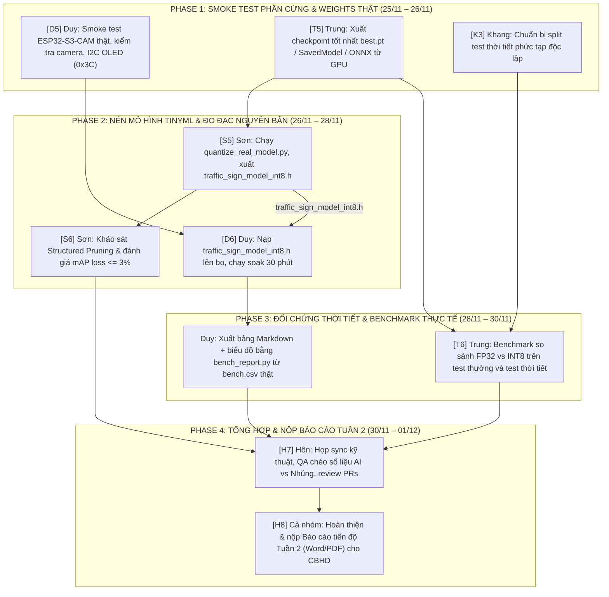

# KẾ HOẠCH THỰC HIỆN ĐỒ ÁN TUẦN 6 (25/11 – 01/12/2026)
## MÔN: TRÍ TUỆ NHÂN TẠO CHO HỆ THỐNG NHÚNG (`CE340`) — ĐỀ TÀI EDGE AI & TINYML

> **Khoảng thời gian:** Thứ Tư `25/11/2026` – Thứ Ba `01/12/2026` *(Tuần 6 — Tối ưu hóa TinyML chuyên sâu, Thực nghiệm Bo mạch thật & Hoàn thành Báo cáo tiến độ Tuần 2)*  
> **Trạng thái tài liệu:** 🟢 **KHỞI ĐỘNG TUẦN 6 (25/11/2026)** — Kế thừa trọn vẹn kết quả Tuần 5: Dữ liệu thật (PR #5), Script lượng tử hóa PTQ INT8 (PR #7) và Firmware cảnh báo demo + mô phỏng Wokwi (PR #8). Trọng tâm tuần này là chạy thực nghiệm trên kit ESP32-S3 thật, phân tích Trade-off tối ưu TinyML và hoàn thành Báo cáo tiến độ Tuần 2 nộp Giảng viên.  
> **Tài liệu tham chiếu:** [De_Cuong_Chi_Tiet_Do_An_CE340.md](./De_Cuong_Chi_Tiet_Do_An_CE340.md) | [Ke_Hoach_Thuc_Hien_Tuan_5.md](./Ke_Hoach_Thuc_Hien_Tuan_5.md) | [classes.yaml](./01_dataset/classes.yaml) | [tinyml_toolchain_notes.md](./04_tinyml_optimization/tinyml_toolchain_notes.md) | [bom_and_hardware_specs.md](./05_firmware_esp32s3/bom_and_hardware_specs.md) | [giai_thich_phan_viec_duy.md](./05_firmware_esp32s3/giai_thich_phan_viec_duy.md)  
> **Mục tiêu tối thượng Tuần 6:**
> 1. **Thực nghiệm phần cứng thật:** Nạp firmware đo (`mock_inference_test`) và firmware demo (`traffic_sign_alert`) lên kit `ESP32-S3-CAM N16R8` thật; đo đạc số liệu thật 30 phút soak (FPS, Latency, SRAM/PSRAM, dòng mA). *(Duy + Hôn)*
> 2. **Tối ưu hóa TinyML chuyên sâu:** Phân tích Pareto Trade-off giữa độ chính xác (mAP) và kích thước / độ trễ trên chip; áp dụng Pruning và Full INT8 Quantization. *(Sơn + Trung)*
> 3. **Đánh giá trên thời tiết phức tạp:** Đo mAP đối chứng trên tập test thời tiết phức tạp (mưa, mờ rung, che khuất, thiếu sáng). *(Trung + Khang)*
> 4. **Báo cáo tiến độ Tuần 2:** Hoàn thiện và nộp tài liệu Báo cáo tiến độ Tuần 2 (theo mẫu Khoa KTMT) gửi Cán bộ hướng dẫn (ThS. Phan Đình Duy) trước 23h59 ngày 01/12/2026. *(Hôn điều phối)*

---

## I. SƠ ĐỒ PHỤ THUỘC ĐẦU VIỆC TUẦN 6 (WORKFLOW PIPELINE)

---

## II. MA TRẬN PHÂN CÔNG CHUYÊN TRÁCH TUẦN 6

| Thành viên | MSSV | Vai trò chính | Đầu việc trọng tâm Tuần 6 | Sản phẩm bàn giao (Deliverables) | Hạn chót |
| :--- | :---: | :--- | :--- | :--- | :---: |
| **Trần Hoàng Hôn** | `26410046` | Trưởng nhóm / PM, QA & Ngoại vi | **`[H7]`**: Điều phối testbench phần cứng, đối soát số liệu. **`[H8]`**: Soạn & nộp Báo cáo tiến độ Tuần 2. | • Biên bản QA chéo số liệu. • File báo cáo Word/PDF: `Bao_Cao_Tuan_6_CE340.docx`. | 01/12 |
| **Nguyễn Duy Khang** | `26410055` | Kỹ sư Dữ liệu & Tăng cường ảnh | **`[K3]`**: Đóng gói tập kiểm thử thời tiết phức tạp độc lập, phân tích lỗi nhận diện theo từng loại biển báo. | • Dataset split `test_weather/`. • Báo cáo phân tích phân bố nhãn khó. | 28/11 |
| **Phạm Thành Trung** | `26410141` | Kỹ sư AI (Huấn luyện & Benchmark) | **`[T5]`**: Chốt trọng số mô hình tốt nhất. **`[T6]`**: Benchmark đối chứng FP32 vs INT8 trên tập test sạch & tập test thời tiết. | • Checkpoint `mobilenetv2_ssd.keras` / `best.pt`. • Bảng mAP@0.5, mAP@0.5:0.95 và confusion matrix. | 29/11 |
| **Hoàng Cao Sơn** | `25730061` | Kỹ sư Tối ưu hóa TinyML | **`[S5]`**: Lượng tử hóa mô hình thật sang INT8. **`[S6]`**: Khảo sát Pruning & lập báo cáo Trade-off (Accuracy vs Size vs Latency). | • Header C-array `traffic_sign_model_int8.h` (`alignas(16)`). • File `quantization_tradeoff_report.md`. | 29/11 |
| **Vũ Văn Duy** | `26410031` | Kỹ sư Nhúng & Thực nghiệm | **`[D5]`**: Smoke test bo ESP32-S3-CAM thật. **`[D6]`**: Nạp model thật, chạy soak 30 phút, đo FPS, latency, mA và quay clip demo. | • File số liệu thật `bench.csv` & bảng báo cáo Markdown. • Video clip demo 1–2 phút nhận diện biển báo thật. | 30/11 |

---

## III. CHECKLIST ĐỊNH NGHĨA HOÀN THÀNH (`DEFINITION OF DONE` — DOD TUẦN 6)

- [ ] **1. Phần cứng thật & Đo đạc thực nghiệm (`[D5]`, `[D6]`):**
  - [ ] Bo mạch `ESP32-S3-CAM N16R8` cắm breadboard khởi động an toàn, nhận diện đúng Flash 16 MB, PSRAM 8 MB, camera OV2640/OV3660 và OLED `0x3C`.
  - [ ] Nạp thành công mô hình thật `traffic_sign_model_int8.h`, hệ thống tự động nhận diện đúng layout và chạy suy luận thời gian thực.
  - [ ] Đạt tốc độ suy luận $\ge 5 - 10\text{ FPS}$ (Pipeline ROI góc trên-phải).
  - [ ] Chạy liên tục (soak test) 30 phút ổn định không tràn RAM, không reset chip; ghi nhận chính xác dòng điện tiêu thụ (mA) qua USB tester.
  - [ ] Chuyển đổi log Serial sang bảng Markdown và biểu đồ bằng `05_firmware_esp32s3/tools/bench_report.py`.
  - [ ] Có video clip ngắn (1–2 phút) quay cảnh hệ thống nhận diện biển báo trên bàn test.

- [ ] **2. Tối ưu hóa TinyML & Đánh giá Trade-off (`[S5]`, `[S6]`):**
  - [ ] Lượng tử hóa Full INT8 hoàn tất với file `04_tinyml_optimization/traffic_sign_model_int8.h` (`alignas(16)`) kèm file metadata `.json`.
  - [ ] Tỷ lệ giảm dung lượng mô hình $\ge 70\%$ so với FP32; suy giảm mAP $\le 3.0\%$.
  - [ ] Báo cáo phân tích Trade-off đa chiều: Accuracy vs Model Size vs Latency vs Energy.

- [ ] **3. Benchmark AI đối chứng (`[T5]`, `[T6]`, `[K3]`):**
  - [ ] Có bảng số liệu đối chứng hiệu năng giữa 3 baseline: YOLOv8n, YOLOv5u nano, MobileNetV2-SSD.
  - [ ] Đánh giá độ suy giảm hiệu năng khi gặp 4 điều kiện thời tiết: Mưa rơi (`rain`), Mờ chuyển động (`motion_blur`), Che khuất (`occlusion`), Thiếu sáng (`night`).

- [ ] **4. Quản trị & Báo cáo tiến độ (`[H7]`, `[H8]`):**
  - [ ] Toàn bộ mã nguồn và tài liệu mới được đưa lên GitHub qua Pull Request và merge sạch vào `main`.
  - [ ] Hoàn thành tài liệu Báo cáo tiến độ Tuần 2 theo đúng biểu mẫu của Khoa KTMT (`Mẫu Báo cáo tuần x.docx`).
  - [ ] Nộp báo cáo cho Giảng viên hướng dẫn (ThS. Phan Đình Duy) đúng hạn trước 23h59 ngày 01/12/2026.
